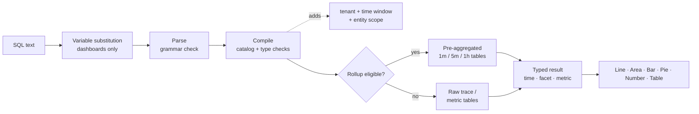

## SQLでクエリを実行する方法：クエリの仕組み {#how-to-query-with-sql-the-mechanics-of-querying}

ツールを導入する前に、その仕組みを把握しておくことが重要です。 このドキュメントでは、データの探索方法、クエリの実行時の動作について説明し、単純なクエリから複雑なクエリの例を説明します。

### データの探索

SQLを使用する最適な方法は、**Explore**&#x200B;を開いて、自分のデータで試すことです。

> **ヒント**
>
> SQLは読み取り専用です。 データを変更または削除することはできず、すべてのクエリはテナントにスコープされます。

1. **アプリの上部にあるテナントスイッチャーで顧客**&#x200B;を選択します。SQLには1つのテナントが必要です。
2. **探索**&#x200B;を開きます。 「**ビジュアルビルダー**」タブでは、**から** （エンティティ）、**集計**、**フィルター**、**ファセット**&#x200B;および&#x200B;**時系列**&#x200B;を選択できます。 生成されたSQLが下に表示されます。
3. クエリを直接編集するには、**SQL** タブに切り替えます。 エディターは、入力時にエンティティ、属性、関数を自動補完します。
4. 右側の&#x200B;**クエリガイド** パネルを開いて、エンティティ、属性タイプ、クエリの例を参照します。 サンプルをクリックして読み込みます。
5. 「**検証**」をクリックしてクエリを実行せずに確認するか、**実行** （⌘/Ctrl + Enter）をクリックして結果を確認します。

最初に`FROM`を入力してエンティティを選択し、`SELECT`と属性を追加します。

```sql
FROM Transaction SELECT name, duration LIMIT 20
```

これは基本的な&#x200B;**イベントクエリ**&#x200B;です。 20件のインバウンドリクエストを返し、各リクエストの操作名と期間を表示します。

次に、属性を&#x200B;**集計**&#x200B;に置き換え、結果をグループ化します。

```sql
FROM Transaction SELECT count(*) FACET service
```

これは、サービスごとにリクエストをカウントし、レポートするサービスを示します。

> **重要**
>
> **ビルドする前に見つける。** 属性の可用性は、各サービスのインストルメント方法によって異なります。 最初に新しいテナントで[検出クエリ ](#101-data-discovery)を実行し、実際にデータを含むサービス、ホスト、属性、指標を確認します。

### クエリの実行方法

クエリを実行すると、Observability Insightsは次のようになります。

1. **変数**&#x200B;を置換し、`{{name}}` トークンを現在のダッシュボード変数選択に置き換えます。 これは、ブラウザー、ダッシュボードでのみ発生します。
2. **テキストを解析**&#x200B;します。 セミコロン、生のSQL関数、サブクエリなど、SQL文法の外のものはすべて拒否されます。
3. クエリを&#x200B;**コンパイル**&#x200B;します。 各論理属性（例えば`urlPath`）を格納された式にマッピングし、型と関数を検証します。
4. **必須ガード**&#x200B;を追加します。テナント、時間ウィンドウ、エンティティの固定範囲（例：`Transaction`はサーバーのスパンのみ）です。
5. **事前集計された** ロールアップ **テーブルに対する**&#x200B;対象の時系列クエリをルーティングします。 これは自動であり、結果は生データと一致します。
6. **15秒のタイムアウトとバイト読み取り予算を使用してクエリを実行**&#x200B;し、UIがレンダリングする入力された列（時間、ファセット、指標）を返します。



### 結果シェイプ

各クエリは、4つのシェイプのうちの1つを返します。 図形によって、どのグラフが意味があるのかが決まります。

| シェイプ | How you get it | 既定の`LIMIT` | 最適な視覚化 |
| --------------- | ---------------------------------------------------- | --------------- | ------------------ |
| **看板** | `FACET`および`TIMESERIES`を含まない集計のみ | 1 | 数値 |
| **ファセット** | 集計+ `FACET` | 10 | バー、円、テーブル |
| **時系列** | 集計+ `TIMESERIES` （`FACET`の有無） | 5,000行 | 線、面、棒グラフ |
| **イベント** | Raw属性のみ | 100 | テーブル |

<a id="time-window-precedence"></a>

### 時間ウィンドウの優先順位

| クエリが実行される場所 | 適用されるウィンドウ |
| --------------------------------- | ---------------------------------------------------------------------------------- |
| **ダッシュボードウィジェット** | ダッシュボード **時間選択**。 クエリ内の`SINCE`/`UNTIL`は無視されます。 |
| **ウィジェットのプレビューを追加** | **ウィジェットを追加** ダイアログ内の時間ピッカー。 |
| **探索** | グローバル時間ピッカー。 ピッカー範囲がアクティブな場合、`SINCE`/`UNTIL`は無視されます。 |
| 明示的な範囲を持たない&#x200B;**API** | クエリ内の`SINCE`/`UNTIL`は、既定値は過去1時間です。 |

> **メモ**
>
> ピッカーはダッシュボードとエクスプローラーで勝利するため、このガイドでは通常`SINCE`がダッシュボードクエリから除外されます。 クエリの時間ピッカーを常に定義する必要があります。
