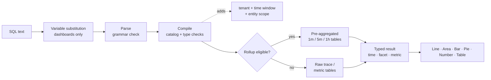

<a id="top"></a>

# Adobe Observability Insights ダッシュボード/クエリドキュメント

**Adobe Observability Insights Query Language （SQL）** — Adobe Observability Insightsのテレメトリのクエリ、グラフ、およびダッシュボード。

|                |                                                                  |
| -------------- | ---------------------------------------------------------------- |
| **適用先** | インサイト UI → **探索**&#x200B;および&#x200B;**ダッシュボード** （カスタムダッシュボード） |
| **オーディエンス** | SQLを知っているエンジニア、SRE、パワーユーザー |

>[!TIP]
> `sql`とマークされたすべてのコードブロックは、SQL クエリであり、**SQLを探索**&#x200B;または&#x200B;**ダッシュボード→直接ペーストして、ウィジェット→SQL**→追加できます。

## ドキュメントマップ

| セクション | Doc | 学習内容 |
| --------------- | ----------------------------------------------------------------------------------- | ------------------------------------------------------------------------------------------- |
| **基本を学ぶ** | [1. SQL](#1-get-started-with-SQL-the-language-of-your-telemetry)の基本を学ぶ | SQLとは何か、クエリできること、どこで使用するか、基本的なルールは |
|                 | [2. SQL](#2-how-to-query-with-SQL-the-mechanics-of-querying)でクエリする方法 | データの探索方法、クエリの実行方法、動作した例 |
|                 | [3. グラフとダッシュボード ](#3-charts-and-dashboards-visualizing-your-data) | クエリをグラフに変換し、ダッシュボードをステップバイステップで構築する方法 |
| **参照** | [4. SQL参照](#4-SQL-reference) | あらゆる句、関数および演算子（例を含む） |
|                 | [5. データディクショナリ ](#5-data-dictionary) | クエリできるあらゆるエンティティと属性 |
| **チュートリアル** | [6. チュートリアル 1：最初のクエリ ](#6-tutorial-1-your-first-queries) | `SELECT`, `FROM`, `LIMIT`，集計，時間，`TIMESERIES`, `WHERE`, `FACET` |
|                 | [7. チュートリアル 2: データの制御](#7-tutorial-2-control-your-data) | 一意の値、最新/初期、パーセンタイル、ラベル、ワイルドカード、順序 |
|                 | [8. チュートリアル 3: ダッシュボードを進める](#8-tutorial-3-advance-your-dashboarding) | 条件付き集計、Apdex、レート、ヒストグラム、数式、変数、セクション |
|                 | [9. チュートリアル 4：高度な関数](#9-tutorial-4-advanced-functions) | `stddev`、`derivative`、ランク `latest`、合計シェア、スパン構成、指標の検出 |
| **例** | [10. クッキーブックのクエリ ](#10-query-cookbook) | トピック別にすぐに使用できる100以上のクエリ（AEMを含む） |
|                 | [11. ダッシュボードのブループリント ](#11-dashboard-blueprints) | 各ウィジェットのクエリが表示される、10種類の包括的で複雑なダッシュボード |
| **操作** | [12. パフォーマンス ](#12-performance) | ロールアップ、クエリ予算、ダッシュボードを高速に保つ方法 |
|                 | [13. トラブルシューティング ](#13-troubleshooting) | あらゆるエラーメッセージ、その意味、修正方法 |
|                 | [14. 付録](#14-appendix) | 制限、書き出しファイル形式、ワンページチートシート |

# 今すぐ始める

## &#x200B;1. SQLの基本を学ぶ：テレメトリの言語

SQLは、Observability Insights データのSQLのようなクエリ言語です。 すべてのカスタムダッシュボードウィジェットと&#x200B;**Explore** ページの背後にある同じ言語なので、チームが必要とするビューを構築できます。

SQLは、`Transaction`、`Span`、`CpuUtilization`などの使いやすい論理ビューである&#x200B;**エンティティ**&#x200B;で動作します。 ストレージテーブルを直接クエリすることはできません。 Observability Insightsは、各SQL クエリを、安全でパラメータ化されたウェアハウスクエリにコンパイルします。 このクエリは、常にテナントと選択した時間ウィンドウに対してスコープを設定します。

```sql
SELECT count(*) AS requests FROM Transaction TIMESERIES AUTO
```

### SQLで可能なこと

SQLを使用して以下を行います。

- スループット、エラー率、レイテンシ、Apdex、CPU、メモリ、JVM ヒープ、ディスク、ネットワークの&#x200B;**ビルド チャート**&#x200B;を時系列で作成します。
- **特定の質問**&#x200B;に答える（「パブリッシュ層のどのURL パスにp95が最も低いか？」） または「どのダウンストリームドメインが失敗しているか？」
- **KPIから個々のリクエストとトレース IDまで掘り下げて、インシデントを調査**。
- **KPI、トレンド、テーブル、数式、メモ、セクションヘッダーおよび変数を使用してダッシュボード**&#x200B;を作成します。
- **Sling、JSP、JCR、DispatcherおよびGraphQL属性を使用してAEM ワークロードをプロファイル** （Adobe Experience Manager）。

SQLは、個々のリクエスト行を返す&#x200B;**イベントクエリ**&#x200B;と、合計、パーセンタイル、レート、分類、時系列を返す&#x200B;**集計クエリ**&#x200B;の両方をサポートしています。

>[!TIP]
> **ダッシュボードのテンプレート → ダッシュボードを作成**&#x200B;はすべてSQLから構築されています。 鉛筆アイコンを使用して任意のテンプレートウィジェットを開き、クエリを表示および学習します。

### クエリできること

SQLは、4つのデータファミリーをクエリできます。 完全なリストは[ データディクショナリ ](#5-data-dictionary)にあります。

| 家族 | エンティティ | よくある質問 |
| ------------------------------------ | ------------------------------------------------------------------------------------------------------------------------------------------------------------------ | -------------------------------------------------------------------- |
| **トレース （APM）** | `Transaction` （インバウンドリクエスト）、`AppRequest` （リクエスト + メッセージコンシューマー）、`Span` （スパンごと） | スループット、待ち時間、エラー、Apdex、ダウンストリームコール、AEMコードパス |
| **キュレートされたホストとランタイムの指標** | `CpuUtilization`、`MemoryUtilization`、`LoadAverage5m`、`DiskUtilization`、`NetworkReceiveRate`、`JvmHeapUsed`、`JvmThreadCount`、`DispatcherRequestRate`など | 飽和度、容量、JVMの正常性、Dispatcherの負荷 |
| **汎用指標** | `MetricGauge`, `MetricSum` | 名前による任意のOpenTelemetry指標、指標の検出 |
| **事前集計されたスパン構成** | `SpanBreakdown` | トランザクションを構成する子操作 |

>[!NOTE]
> ログ、アラート定義、インベントリ関係は使用できません。

### SQLの使用場所

| ここで、 | 開く方法 | 何のためのものか |
| ----------------------- | ------------------------------------------------------------------------------ | ------------------------------------------------------------------------------------------------------------------------------------------------------------------------------------ |
| **探索** | 左ナビゲーション → **探索** | Ad Hoc Analysis: **Visual Builder**&#x200B;または&#x200B;**SQL** タブ、**Validate**&#x200B;を使用し、次に&#x200B;**Run** （⌘/Ctrl + Enter）を使用します。 **履歴**&#x200B;および&#x200B;**保存済み** クエリと&#x200B;**クエリガイド** パネルが含まれます。 |
| **ダッシュボード** | **ダッシュボード**→左ナビゲーション→ダッシュボードを開いたり作成したりす→**ウィジェットを追加** | 永続的なチャート、KPI、テーブルをダッシュボードに統合。 |
| **数式ウィジェット** | **数式→ウィジェットを追加** | 2～6個のSQL クエリを算術演算（比率、ヘッドルーム、消化率）と組み合わせます。 |
| **ダッシュボード変数** | クエリからの&#x200B;**+変数→** | SQL `FACET` クエリの個別の値からピッカーを入力します。 |
| **クエリ調査** | グラフにカーソルを合わせ→クエリを調べる | 組み込みチャートまたはダッシュボード チャートのSQLを参照します。 |

### SQL クエリ構造

SQLは句ベースの構文に従います。 このクエリは、選択したウィンドウ内のすべてのインバウンドリクエストをカウントします。

```sql
SELECT count(*) FROM Transaction
```

次に、すべての使用可能な句を示します。

```text
SELECT  function(attribute) [FILTER (WHERE condition)] [AS alias] [, ...]
        | attribute [AS alias] [, ...]
FROM    Entity
  [WHERE      condition [AND | OR ...]]
  [FACET      attribute [, attribute ...]]        -- up to 5
  [SINCE      n unit [AGO]]
  [UNTIL      NOW | n unit [AGO]]
  [TIMESERIES AUTO | MAX | n unit]
  [ORDER BY   alias [ASC | DESC]]
  [LIMIT      number]                              -- 1 to 5000
```

SQLのルールは次のとおりです。

| ルール | 詳細 |
| ---------------------------- | ------------------------------------------------------------------------------------------------------------------------------------------------------------------------------------ |
| **必要な句** | `SELECT`と`FROM`が必要です。 その他の句はすべてオプションです。 次のいずれかから開始できます：`FROM Transaction SELECT count(*)`も有効です。 |
| **句の順序** | `FROM`以降の句は、任意の順序で表示できます。 各句は1回のみ表示できます。 |
| **クエリサイズ** | クエリは4 KB以下である必要があります。 |
| **大文字と小文字の区別** | キーワード、関数名、エンティティ名および属性名は、大文字と小文字を区別しない&#x200B;**です。**&#x200B;文字列値&#x200B;**は**&#x200B;大文字と小文字が区別されます（`'Error'` ≠ `'error'`）。 |
| **文字列** | 一重引用符を使用：`WHERE status = 'Error'`。 引用符を含めるには、次の2倍にしてください：`'O''Brien'`。 二重引用符は使用できません。 |
| **リテラル** | 文字列、数値（負と小数を含む）、`TRUE`、`FALSE`、`NULL`です。 |
| **属性名** | 名前には、文字、数字、`_`および`.`を含めることができます（例：`http.statusCode`）。 バックティックは必要ありません。 |
| **集計と属性** | クエリは、生の属性（イベントリスト）または集計を選択します。両方を選択することはできません。 グループ化するには、`FACET`を使用します。 |
| **時間ウィンドウ** | デフォルトは過去1時間です。 最大は31日です。 ダッシュボードとエクスプローラーで、**時間ピッカー**&#x200B;がウィンドウを設定します（[時間ウィンドウ ](#time-window-precedence)を参照）。 |
| **サポートされていません** | セミコロン、コメント、サブクエリ、結合、`SELECT *`、属性間の計算（`SELECT`、`HAVING`、`COMPARE WITH`）。 代替案については、[SQLが実行しない処理](#what-SQL-doesnt-do)を参照してください。 |

### 次の手順

- [SQLを使用してクエリを実行する方法](#2-how-to-query-with-SQL-the-mechanics-of-querying): データを検索し、クエリの実行方法を理解します。
- [ グラフとダッシュボード ](#3-charts-and-dashboards-visualizing-your-data)：結果を視覚化します。
- [ チュートリアル 1：最初のクエリ ](#6-tutorial-1-your-first-queries)：実践的なチュートリアル。
- [SQL参照](#4-SQL-reference)：完全な構文、句、関数。

[↑ トップへ戻る](#top)

## &#x200B;2. SQLでクエリを実行する方法：クエリの仕組み

ツールを導入する前に、その仕組みを把握しておくことが重要です。 このドキュメントでは、データの探索方法、クエリの実行時の動作について説明し、単純なクエリから複雑なクエリの例を説明します。

### データの探索

SQLを使用する最適な方法は、**Explore**&#x200B;を開いて、自分のデータで試すことです。

>[!TIP]
> SQLは読み取り専用です。 データを変更または削除することはできず、すべてのクエリはテナントにスコープされます。

1. **アプリの上部にあるテナントスイッチャーで顧客**&#x200B;を選択します。SQLには1つのテナントが必要です。
2. **探索**&#x200B;を開きます。 「**ビジュアルビルダー**」タブでは、**から** （エンティティ）、**集計**、**フィルター**、**ファセット**&#x200B;および&#x200B;**時系列**&#x200B;を選択できます。 生成されたSQLが下に表示されます。
3. クエリを直接編集するには、**SQL** タブに切り替えます。 エディターは、入力時にエンティティ、属性、関数を自動補完します。
4. 右側の&#x200B;**クエリガイド** パネルを開いて、エンティティ、属性タイプ、クエリの例を参照します。 サンプルをクリックして読み込みます。
5. 「**検証**」をクリックしてクエリを実行せずに確認するか、**実行** （⌘/Ctrl + Enter）をクリックして結果を確認します。

最初に`FROM`を入力してエンティティを選択し、`SELECT`と属性を追加します。

```sql
FROM Transaction SELECT name, duration LIMIT 20
```

これは基本的な&#x200B;**イベントクエリ**&#x200B;です。 20件のインバウンドリクエストを返し、各リクエストの操作名と期間を表示します。

次に、属性を&#x200B;**集計**&#x200B;に置き換え、結果をグループ化します。

```sql
FROM Transaction SELECT count(*) FACET service
```

これは、サービスごとにリクエストをカウントし、レポートするサービスを示します。

>[!IMPORTANT]
> **ビルドする前に見つける。** 属性の可用性は、各サービスのインストルメント方法によって異なります。 最初に新しいテナントで[検出クエリ ](#101-data-discovery)を実行し、実際にデータを含むサービス、ホスト、属性、指標を確認します。

### クエリの実行方法

クエリを実行すると、Observability Insightsは次のようになります。

1. **変数**&#x200B;を置換し、`{{name}}` トークンを現在のダッシュボード変数選択に置き換えます。 これは、ブラウザー、ダッシュボードでのみ発生します。
2. **テキストを解析**&#x200B;します。 セミコロン、生のSQL関数、サブクエリなど、SQL文法の外のものはすべて拒否されます。
3. クエリを&#x200B;**コンパイル**&#x200B;します。 各論理属性（例えば`urlPath`）を格納された式にマッピングし、型と関数を検証します。
4. **必須ガード**&#x200B;を追加します。テナント、時間ウィンドウ、エンティティの固定範囲（例：`Transaction`はサーバーのスパンのみ）です。
5. **事前集計された** ロールアップ **テーブルに対する**&#x200B;対象の時系列クエリをルーティングします。 これは自動であり、結果は生データと一致します。
6. **15秒のタイムアウトとバイト読み取り予算を使用してクエリを実行**&#x200B;し、UIがレンダリングする入力された列（時間、ファセット、指標）を返します。



### 結果シェイプ

各クエリは、4つのシェイプのうちの1つを返します。 図形によって、どのグラフが意味があるのかが決まります。

| シェイプ | How you get it | 既定の`LIMIT` | 最適な視覚化 |
| --------------- | ---------------------------------------------------- | --------------- | ------------------ |
| **看板** | `FACET`および`TIMESERIES`を含まない集計のみ | 1 | 数値 |
| **ファセット** | 集計+ `FACET` | 10 | バー、円、テーブル |
| **時系列** | 集計+ `TIMESERIES` （`FACET`の有無） | 5,000行 | 線、面、棒グラフ |
| **イベント** | Raw属性のみ | 100 | テーブル |

<a id="time-window-precedence"></a>

### 時間ウィンドウの優先順位

| クエリが実行される場所 | 適用されるウィンドウ |
| --------------------------------- | ---------------------------------------------------------------------------------- |
| **ダッシュボードウィジェット** | ダッシュボード **時間選択**。 クエリ内の`SINCE`/`UNTIL`は無視されます。 |
| **ウィジェットのプレビューを追加** | **ウィジェットを追加** ダイアログ内の時間ピッカー。 |
| **探索** | グローバル時間ピッカー。 ピッカー範囲がアクティブな場合、`SINCE`/`UNTIL`は無視されます。 |
| 明示的な範囲を持たない&#x200B;**API** | クエリ内の`SINCE`/`UNTIL`は、既定値は過去1時間です。 |

>[!NOTE]
> ピッカーはダッシュボードとエクスプローラーで勝利するため、このガイドでは通常`SINCE`がダッシュボードクエリから除外されます。 クエリの時間ピッカーを常に定義する必要があります。

### SQL クエリの例

例をいくつか挙げてみましょう。 このクエリの場合：

- エンティティとして`Transaction`を選択します。
- `SELECT`を使用して、95 パーセンタイル期間を計算します。
- サービス別に結果をグループ化するには、`FACET`を使用します。
- `TIMESERIES AUTO`を使用して、自動的にサイズ調整された間隔でデータをプロットします。

```sql
FROM Transaction SELECT percentile(duration, 95) AS p95 FACET service TIMESERIES AUTO
```

これにより、折れ線グラフでサービスごとに1行が生成され、デフォルトでは最もビジーな10のサービスが表示されます。

以下の各例をクリックして展開します。

<details>
<summary><strong> インバウンドリクエストの基本クエリ </strong></summary>

すべてのインバウンドリクエストの平均応答時間（ミリ秒単位）:

```sql
SELECT average(duration) FROM Transaction
```

</details>

<details>
<summary><strong> ドットを含む属性名</strong></summary>

ドット付きの名前は引用符で囲む必要はありません。

```sql
SELECT count(*) FROM Transaction WHERE http.statusCode >= 500 FACET http.route
```

</details>

<details>
<summary><strong>複数の列を返すクエリ </strong></summary>

1つのクエリ内の複数の集計がテーブルの列になります。

```sql
SELECT count(*) AS requests, average(duration) AS avgMs, percentile(duration, 95) AS p95, max(duration) AS maxMs FROM Transaction FACET service
```

</details>

<details>
<summary>1回のパスで<strong>条件付き集計</strong></summary>

合計、エラー、5xxを並べて表示：

```sql
SELECT count(*) AS total, count(*) FILTER (WHERE status = 'Error') AS errors, count(*) FILTER (WHERE http.statusCode >= 500) AS http5xx FROM Transaction FACET service
```

</details>

<details>
<summary><strong> キュレートされた指標のクエリ </strong></summary>

ホストあたりの時間の平均CPU:

```sql
SELECT average(value) AS cpu FROM CpuUtilization FACET host TIMESERIES AUTO
```

</details>

<details>
<summary><strong>任意のOpenTelemetry メトリックを名前</strong>でクエリしています</summary>

キュレーションされたエンティティを持たない指標には`MetricGauge` / `MetricSum`を使用します：

```sql
SELECT latest(value) AS bytesUsed FROM MetricSum WHERE metric = 'jvm.memory.used' FACET host, pool
```

</details>

<a id="what-SQL-doesnt-do"></a>

### SQLで不可能なこと

SQLは意図的に小さい。 これにより、クエリを安全に、迅速に、テナント分離できます。 これらの機能のいずれかが必要な場合は、代替を使用します。

| 機能 | ステータス | 代替 |
| ------------------------------------------- | ------------- | ------------------------------------------------------------------------------------------------------------ |
| `SELECT *` | サポート対象外 | 必要な属性をリストします：`SELECT timestamp, name, duration, traceId …`。 |
| 生の属性と集計の混在 | サポート対象外 | `FACET attr`または`latest(attr)` / `earliest(attr)`を使用してください。 |
| `SELECT`の計算（`a - b`、`count(*) / 60`） | サポート対象外 | **式** ウィジェット （ダッシュボード）。 |
| 結合とサブクエリ | サポート対象外 | **式** ウィジェット、または2つのウィジェットを並べて表示します。 |
| `HAVING` | サポート対象外 | `ORDER BY alias` + `LIMIT`. |
| `COMPARE WITH` | サポート対象外 | 時間ピッカーを変更するか、2つのウィジェットを別のタブに配置します。 |
| `FACET CASES` | サポート対象外 | 1つのケースにつき1つの`count(*) FILTER (WHERE …)`列（チュートリアル 3](#83-group-values-into-cases-with-filter)を参照）。[ |
| `histogram()` | サポート対象外 | バケット化された`FILTER`列（[ チュートリアル 3](#84-build-a-latency-histogram)を参照）。 |
| `uniques()` / `keyset()` | サポート対象外 | `FACET attr LIMIT n`には個別の値が一覧表示されます。 検出クエリには、指標と入力された属性が一覧表示されます。 |
| `RLIKE` （正規表現） | サポート対象外 | `LIKE` / `NOT LIKE` （ワイルドカード `%`および`_`）、または`IN (…)`。 |
| コメント （`--`、`//`、`/* */`） | サポート対象外 | ウィジェットのタイトルまたは&#x200B;**テキスト** ウィジェットにメモを配置します。 |
| `SINCE`の絶対日付 | サポート対象外 | 時間ピッカーの絶対範囲を使用します。 |
| 型変換（`numeric()`, `string()`） | 不要 | 属性はカタログに入力されます。 |

[↑ トップへ戻る](#top)

## &#x200B;3. チャートとダッシュボード：データの可視化

必要な情報が見つかります。 チャートとダッシュボードは、その情報を組織にとって有益なものにします。 このドキュメントでは、SQLの結果がどのようにグラフになるか、ダッシュボードの構築、整理、共有の方法について説明します。

### グラフ

各SQL結果は、6種類のグラフのいずれかとしてレンダリングできます。

| グラフのタイプ | 次の用途で使用します | クエリシェイプ |
| --------------- | --------------------------------------------------- | ----------------------------------------------- |
| **行** | 時間の経過に伴うトレンド。ファセット値ごとに1行 | 集計+ `TIMESERIES` |
| **領域** | サービス別スループットなどのボリュームの推移 | 集計+ `TIMESERIES` |
| **バー** | カテゴリの比較；時系列のスパース | 集計+ `FACET` （± `TIMESERIES`） |
| **パイ / ドーナツ** | 全体の共有（ステータスコードミックス、層別トラフィック） | 1つの集計+ `FACET`、値が少ない |
| **数値** | 単一のKPI （オプションの色しきい値を含む） | ビルボード（集計のみ） |
| **テーブル** | グループまたはイベントリストごとに複数の集計 | 複数の集計+ `FACET`、または生の属性 |

ウィジェットをダッシュボードに追加すると、次のことが可能になります。

- **編集**&#x200B;そのクエリ、タイトル、チャートの種類、単位（鉛筆アイコン）。
- **複製**&#x200B;して、別の階層の同じグラフなどのバリエーションを作成します。
- **現在の行のCSV**&#x200B;または2×解像度の&#x200B;**PNG**&#x200B;をダウンロードします。
- グリップハンドルで&#x200B;**ドラッグ**&#x200B;し、右下隅から&#x200B;**サイズ変更**&#x200B;します。

### ダッシュボード

チャートは単独でも効果的ですが、ダッシュボードでまとめることができます。 ダッシュボードは、**個のタブ**&#x200B;の名前付きテナントスコープのコレクションです。 各タブは、**ウィジェット**&#x200B;の12列のグリッドです。

| コンセプト | 意味 |
| --------------- | ------------------------------------------------------------------------------------------------------------------------------- |
| **ダッシュボード** | 選択したテナントのサーバーサイドに保存されている1 ～ 40 タブの名前付きコレクション。 |
| **タブ** | 1つのウィジェットのグリッド（最大200）。 鉛筆で名前を変更し、×で削除し、**+**&#x200B;で追加します。 少なくとも1つのタブを残す必要があります。 |
| **ウィジェット** | **単一のクエリ**、**式**、または&#x200B;**テキスト** （メモまたは折りたたみ可能なセクションヘッダー）。 |
| **変数** | グリッドの上にあるピッカー。 値は`{{name}}`として挿入されます。 |
| **時間選択** | ダッシュボード上の各ウィジェットのウィンドウ。 |

### ダッシュボードを作成し、ステップバイステップで

#### 手順1：開始する前に

- **テナントスイッチャーで1人の顧客**&#x200B;を選択します。 **すべてのアカウント**&#x200B;が選択されている間、**ダッシュボードの作成**&#x200B;は無効になっています。 デモ テナントに対してSQLを実行できません。
- **役割。** ダッシュボードアクセス権があれば、誰でもウィジェットを追加、編集、保存できます。 **変数**&#x200B;を作成または編集し、ウィジェットのクエリを調べるには、**組織管理者**&#x200B;と&#x200B;**スーパー管理者**&#x200B;に制限されています。

#### 手順2：ダッシュボードの作成

1. 左側のナビゲーションで&#x200B;**ダッシュボード**&#x200B;を開きます。
2. 「**ダッシュボードを作成**」をクリックします。
3. 開始点を選択：

   | オプション | 得られるもの |
   | ---------------------------- | -------------------------------------------------------------------------------------------------------- |
   | **カスタムダッシュボードの作成** | 空のダッシュボードと1つのタブ。 |
   | **CPUの基本** | CPU（user/system/iowait/steal）、スループット、ロード、Apdexをホストおよび処理します。 |
   | **オールインワンの概要** | KPI （volume, error %, Apdex, p95）, error/traffic pies, CPU/memory tables, JVM threads, slow operations. |
   | **上位トランザクション** | Apdex, p95 by operation, per-host load/CPU, trace IDを持つ最も遅いトランザクション，HTTP エラー分類。 |

4. **name**&#x200B;を入力して確認します。 ダッシュボードのキャンバスが開きます。

#### ステップ 3：キャンバスについて知る

| 領域 | コントロール |
| ---------------------------- | --------------------------------------------------------------------------------------------------------- |
| **一番上のバー** | **ウィジェットを追加**、**ガイド** （アプリ内チートシート）、**読み込み**、**書き出し**、**保存**、時間選択と更新 |
| **バリアブルバー** | テナントバッジ、変数ごとに1つのピッカー、**+変数** （管理者） |
| **タブバー** | タブの切り替え、名前の変更（鉛筆）、削除（×）、追加（+） |
| **グリッド** | 12列。 グリップでウィジェットをドラッグし、角からサイズ変更します（最小2×2）。 |
| **ウィジェットヘッダー** （ホバー時） | CSVのダウンロード、PNGのダウンロード、編集、複製、削除、ドラッグハンドル |

>[!IMPORTANT]
> **保存は明示的です。** レイアウトの変更、新しいウィジェット、タブ、変数は、**保存**&#x200B;をクリックするまでブラウザーに残ります。 ボタンに「_保存中… →保存済み_」または「_保存失敗_」が表示されます（[ トラブルシューティング ](#13-troubleshooting)を参照）。

#### 手順4：ウィジェットの追加

「**ウィジェットを追加**」をクリックします。 ダイアログには、3つのモードがあります。**単一クエリ**、**式**、**テキスト**。 また、独自の時間ピッカーを備えているので、任意のウィンドウでウィジェットをプレビューできます。

**オプション A: ビルダー（コードなし）**

1. _（オプション）_**ヘルパーから開始**：ゴールデンシグナル、APM、AEM、トランザクション、トレースとスパン、インフラストラクチャ、パブリッシャー、JVMとランタイム、データ検出としてグループ化された57のプリセットのいずれかを選択します。 プリセットは、タイトル、クエリ、チャートの種類、および単位を入力します。
2. **表示**: `Count`、`Average`、`Percentile` （およびそのレベル）、`Sum`、`Min`、`Max`または`Unique count`を選択してから、属性を選択します。
3. **から**: エンティティを選択します。
4. **フィルター**: `attribute operator value`の行を追加（`=`、`!=`、`>`、`<`、`>=`、`<=`、`LIKE`）。 すべての行が`AND`と組み合わされます。
5. **グループ化**: 1つのファセット属性を選択し、**上位N**&#x200B;を選択して、最も混雑した系列のみを維持します。
6. **時間の経過**: `TIMESERIES`が有効になり、バケット サイズは&#x200B;**N分ごと**&#x200B;になります。
7. フォームの下で生成されたSQLを確認し、**クエリを実行**&#x200B;をクリックします。

**オプション B: SQL エディター**

1. **Builder**&#x200B;から&#x200B;**SQL**&#x200B;に切り替えます。 既存のウィジェットの編集は、常にSQLで開きます。
2. クエリを入力するか貼り付けます。 ライブカタログからエディターが自動的に補完されます。
3. **クエリガイド** パネルを使用して、エンティティ、属性、および例を参照します。
4. 「**クエリを実行**」をクリックします。 _`<Entity>`クエリが有効です_、ライブプレビュー、概要（`N rows · N time points · N groups`）が表示されます。 3つ未満の時点がある場合、_スパース系列_&#x200B;の警告が表示されます。

>[!TIP]
> ビルダーでは、最も一般的なクエリをカバーしています。 `apdex`、`percentage`、`rate`、`FILTER`、複数の集計、`OR`、`IN`、複数のファセットまたは`ORDER BY`のSQLに切り替えます。

#### 手順5：外観の設定

| フィールド | メモ |
| --------------------- | ----------------------------------------------------------------------------------------------------------------------------------------------------------------------- |
| **タイトル** | 最大200文字。 `{{variable}}` トークンを含めることができます。 |
| **グラフの種類** | `Line`, `Area`, `Bar`, `Pie / Donut`, `Number`, `Table`. 自分で選択するまで、実行するたびにグラフの種類を選択することをお勧めします。 |
| **ユニット** | オプション。最大40文字（`ms`、`%`、`req/s`、`MB`、`bytes`）。 推測単位を使用するには、空白のままにします（例：`duration`では`ms`、`CpuUtilization`では`%`）。 |
| **色のしきい値** | 番号ウィジェットのみ。 フォーム _の最大10個のバンド（`value`以上）→緑/アンバー/赤_。 最も高いマッチングバンドが勝ちます。 |

#### 手順6：ウィジェットを保存し、ダッシュボードを保存する

**保存ウィジェット**&#x200B;は、実行がデータを返した後にのみ有効になります。 新しいウィジェットは6列×3行で、1行に2つ詰まっています。 それらを並べ、上部バーの&#x200B;**保存**&#x200B;をクリックします。

### 適切なグラフの選択

| クエリシェイプ | 最適なチャート | 理由 |
| ------------------------------------------------- | ------------------- | ---------------------------------------------- |
| 1つの集計、いいえ`FACET`、いいえ`TIMESERIES` | **数値** | 単一のKPI タイル。しきい値を追加します。 |
| 集計+ `TIMESERIES` | **行** / **領域** | トレンド。ファセット値ごとに1つの系列。 |
| 集計+ `FACET` （少数の値） | **バー** / **円** | カテゴリーを比較します。全体の共有のための円グラフです。 |
| 複数の集計+ `FACET` | **テーブル** | 各集計は列になります。 |
| Raw属性 | **テーブル** | イベントリスト。 |
| スパース データの集計+ `FACET` + `TIMESERIES` | **バー** | ギャッピーラインよりも読みやすい。 |

数値ウィジェットの1行にテキスト値（例：`latest(host)`）が含まれている場合、ウィジェットは字幕として表示します。

### テキストウィジェット：メモとセクションヘッダー

**ウィジェット→テキストを追加**:

- **メモ**：プレーンテキスト（最大4,000文字、空白行は保持）。 Runbookのリンク、所有者、SLO定義に使用します。 `{{variables}}`がレンダリングされます。
- **セクションヘッダー**：チェックマーク _これをセクションヘッダー_&#x200B;にします。 全幅に広がり、その山形は、次のセクションヘッダーまで、その下にあるすべてのウィジェットを折りたたみます。 **PUBLISH**、**AUTHOR**、**DISPATCHER**&#x200B;などのグループに使用します。

>[!TIP]
> `- PUBLISH`または`- AUTHOR`で終わるウィジェットタイトルには、微妙なカラーキューが表示されます。これにより、AEM ダッシュボードを階層別に簡単にスキャンできます。

### タイムピッカー

- **every** ウィジェットのウィンドウと、クエリ駆動変数オプションのウィンドウを設定します。
- ウィジェットクエリの`SINCE` / `UNTIL`を上書きします。
- 最大ウィンドウは&#x200B;**31日**&#x200B;です。
- `TIMESERIES AUTO`はバケット サイズをウィンドウに適応させます。
- 各ウィジェットのサブタイトルには、実際に適用されたウィンドウが表示されます。例：_1時間前から_。
- 結果は30秒間キャッシュされます。 更新ボタンを使用して強制的に再実行します。

### 変数

変数を使用すると、一度に1つのサービス、環境、しきい値など、1つのダッシュボードで多くのコンテキストに対応できます。 これらは、[ チュートリアル 3](#87-make-dashboards-reusable-with-variables)で詳細に説明されています。

>[!WARNING]
> **現在のビルドの既知の制限：** `{{variables}}`は、ウィジェット **タイトル**&#x200B;と&#x200B;**テキストウィジェット**&#x200B;で動作します。 ウィジェット **SQL**&#x200B;内では、ダッシュボード上でレンダリングされますが、**ウィジェットを追加**&#x200B;のプレビューとサーバーサイドの&#x200B;**保存** チェックでは、`Unexpected character '{'`を含む生の`{{name}}` トークンが拒否されます。 これが修正されるまで、ウィジェットクエリでリテラル値を使用し、**重複**&#x200B;を使用してバリエーションを作成します。

### 数式ウィジェット

数式は、2 ～ 6個の名前付きSQL クエリを数学的に組み合わせます（例：`(errors / total) * 100`）。 KPIが複数のクエリ（比率、ヘッドルーム、レートの合計、消化率など）が必要な場合に1つ使用します。 [ チュートリアル 3](#86-combine-queries-with-formula-widgets)を参照してください。

### 共有、書き出し、読み込み

| アクション | 動作 |
| ------------- | ------------------------------------------------------------------------------------------------------------------------------------------------------------------------- |
| **保存** | 名前、タブ、ウィジェット、レイアウト、変数を保持します。 すべてのウィジェットクエリはサーバーサイドで再検証されます。1つの無効なウィジェットが全体の保存に失敗します。 |
| **書き出し** | `<dashboard-name>.json` （タブ、ウィジェット、変数）をダウンロードします。 |
| **読み込み** | 開いている&#x200B;**ダッシュボードにJSON エクスポート**&#x200B;を読み込み、タブと変数を置き換えます。 次に、**保存**&#x200B;をクリックします。 ヒント：まず空のダッシュボードを作成してから、そのダッシュボードに読み込みます。 |
| **CSV / PNG** | ウィジェットヘッダーからのウィジェットごとのダウンロード。 |

>[!TIP]
> 書き出しと読み込みにより、Gitでダッシュボードをバージョン管理し、ある顧客から別の顧客にダッシュボードを昇格させることができます。 ファイル形式については、[付録](#142-export-file-format)に記載されています。

### ダッシュボードとチャートのパフォーマンスに関するヒント

- **棒や複数系列の行の代わりに、大きな結果セット**&#x200B;に対してテーブルを使用します。
- **ビジーダッシュボードをタブに分割します。** 表示タブのウィジェットのみが実行されます。
- **常に`LIMIT`個のファセット付きクエリ**、特に`urlPath`、`traceId`、`jcr.path`などの基数の高い属性に対して実行されます。
- **低基数の属性（`service`、`kind`、`status`）に対して早期**&#x200B;にフィルターを実行します。
- **固定の小さなバケットには`TIMESERIES AUTO`**&#x200B;を優先し、数分以上を除いて`TIMESERIES MAX`を避けます。
- **ロールアップの長距離傾向をデザインします。** [ パフォーマンス ](#12-performance)を参照してください。

[↑ トップへ戻る](#top)

# 参照

## &#x200B;4. SQL参照

このリファレンスでは、SQLの構文、句、関数および演算子について説明します。 各エントリを展開して、詳細と例を確認します。

**このドキュメントでは、** [ クエリコンポーネント ](#41-query-components) ・ [必要な句](#42-required-clauses) ・ [ オプション句](#43-optional-clauses) ・ [ アグリゲータ関数](#44-aggregator-functions) ・ [演算子と条件](#45-operators-and-conditions) ・ [ タイプ処理](#46-type-handling-blank-vs-null) ・ [SQLからSQL](#47-translate-sql-to-SQL) ・ [NRQLからSQL](#48-translate-nrql-to-SQL)

### 4.1 クエリコンポーネント

```text
SELECT <select-item> [, <select-item> ...]
FROM   <Entity>
[WHERE      <condition>]
[FACET      <attribute> [, <attribute> ...]]          -- up to 5
[SINCE      <n> <unit> [AGO]]
[UNTIL      NOW | <n> <unit> [AGO]]
[TIMESERIES AUTO | MAX | <n> <unit>]
[ORDER BY   <alias-or-selected-name> [ASC | DESC]]
[LIMIT      <1..5000>]

<select-item> := <function>(<args>) [FILTER (WHERE <condition>)] [AS <alias>]
               | <attribute> [AS <alias>]
<unit>        := second | seconds | minute | minutes | hour | hours | day | days | week | weeks
```

>[!NOTE]
> 上記の`--`注釈はドキュメントのみです。 SQL自体はコメントを受け付けません。

### 4.2必要な条項

<details>
<summary><code>SELECT</code> – 返される値</summary>

`SELECT`には、**生の属性** （イベントクエリ）または&#x200B;**アグリゲーター関数** （集計クエリ）が一覧表示されます。 この2つを混ぜることはできません。

| フォーム | 例 | 結果 |
| ------------ | -------------------------------------------------- | ------------------------------------------------- |
| 属性 | `SELECT timestamp, name, duration` | 個々のイベントの行（デフォルトは100） |
| 集計 | `SELECT count(*), average(duration)` | 集計ごとに1つの値（ファセットごと/時間バケットごと） |
| エイリアスを使用 | `SELECT count(*) AS requests` | 列ラベル `requests` |
| 引用符で囲まれたエイリアス | `SELECT percentile(duration, 95) AS 'p95 latency'` | スペースを含むラベル |

イベントリスト：

```sql
SELECT timestamp, service, name, duration, status, traceId FROM Transaction WHERE status = 'Error' LIMIT 50
```

複数の集計：

```sql
SELECT count(*) AS requests, average(duration) AS avgMs, max(duration) AS maxMs FROM Transaction
```

ルール：

- `SELECT *`はサポートされていません。 必要な属性をリストアップします。
- 属性または集計（`sum(a) / count(*)`）間の計算はサポートされていません。 [数式ウィジェット ](#86-combine-queries-with-formula-widgets)を使用します。
- 属性と集計の混在が&#x200B;_Raw属性と集計を混在させることはできません。結果をグループ化するにはFACETを使用してください_。

</details>

<details>
<summary><code>FROM</code> — クエリするエンティティ</summary>

`FROM`さんが、[ データディクショナリ ](#5-data-dictionary)から&#x200B;**one** エンティティを正確に名前を付けます。 エンティティ名では大文字と小文字が区別されません。

```sql
SELECT count(*) FROM Transaction
```

```sql
FROM Span SELECT count(*) FACET kind
```

各エンティティは、固定された範囲を持ちます。 例えば、`Transaction`は常にサーバーのスパンであり、`CpuUtilization`は常に`value`がパーセントに変換されたCPU ビジー指標です。 1つのクエリで複数のエンティティをクエリすることはできません。 エンティティを結合するには、[数式ウィジェット ](#86-combine-queries-with-formula-widgets)を使用します。

</details>

### 4.3 オプション条項

<details>
<summary><code>AS</code> – 列にラベルを付けます</summary>

`AS`を使用して、集計または属性に読みやすい名前を付けます。 エイリアスは、列ヘッダー、凡例ラベルおよび`ORDER BY`で参照する名前になります。

```sql
SELECT count(*) AS requests, percentile(duration, 95) AS p95 FROM Transaction FACET service ORDER BY p95 DESC LIMIT 10
```

スペースを含むラベルには、一重引用符で囲まれた文字列を使用します。

```sql
SELECT percentile(duration, 95) AS 'p95 latency (ms)' FROM Transaction TIMESERIES AUTO
```

</details>

<details>
<summary><code>FACET</code> — グループ結果</summary>

`FACET`は、SQL `GROUP BY`のように、最大&#x200B;**5**&#x200B;属性で結果をグループ化します。

```sql
SELECT count(*) FROM Transaction FACET service, http.method, http.statusCode LIMIT 30
```

| クエリ | `LIMIT n`の意味 | デフォルト |
| ---------------------------- | ----------------------------------------------------------------------------------------------------------------------------- | --------------------------------- |
| `TIMESERIES`を含まない`FACET` | 行数 | 10 |
| `FACET` with `TIMESERIES` | **最上位n系列**。ウィンドウ全体の最初の集計の合計でランク付けされます。 すべてのバケットは、このシリーズ用に保持されます。 | 全シリーズ（5,000行を上限） |

ファセット付き時系列、上位5:

```sql
SELECT count(*) AS requests FROM Transaction FACET service TIMESERIES AUTO LIMIT 5
```

ファセットの値には、文字列または数値を使用できます。 空白の文字列は、独自のグループを形成します。 `WHERE attr != ''`でそれらを除外します。

</details>

<details>
<summary><code>FILTER</code> – 条件付き集計</summary>

任意の集計に`FILTER (WHERE condition)`を追加して、行のサブセットで計算します。 これにより、1回のパスで複数の条件を比較できます。

```sql
SELECT count(*) AS total, count(*) FILTER (WHERE status = 'Error') AS errors, percentile(duration, 95) FILTER (WHERE http.method = 'GET') AS getP95 FROM Transaction FACET service LIMIT 20
```

`FILTER`は、`apdex`、`rate`または`derivative`では使用できません。 `percentage`は既に独自の条件を使用しています。

</details>

<details>
<summary><code>LIMIT</code> – 行数または系列の数</summary>

`LIMIT`は正の整数を取ります。 5,000を超える値は5,000に固定されます。

| 結果シェイプ | デフォルト |
| ------------ | ---------- |
| 看板 | 1 |
| ファセット | 10 |
| 時系列 | 5,000行 |
| イベント | 100 |

```sql
SELECT count(*) FROM Transaction FACET urlPath LIMIT 50
```

>[!TIP]
> クエリ駆動変数と高基数ファセット （`urlPath`、`traceId`、`jcr.path`、`url`）には常に`LIMIT`を設定します。

</details>

<details>
<summary><code>ORDER BY</code> – 結果の並べ替え</summary>

`ORDER BY`は、**選択したエイリアスまたは選択した属性**&#x200B;で並べ替えます。 既定の方向は`DESC`です。

```sql
SELECT count(*) AS requests, percentile(duration, 95) AS p95 FROM Transaction FACET name ORDER BY p95 DESC LIMIT 20
```

| 結果シェイプ | デフォルトの注文 |
| ----------------- | --------------------------------------------------------------------------- |
| 看板/ファセット | 最初の集計、`DESC` |
| 時系列 | 時間、`ASC` |
| イベント | 最初に選択された列、`DESC` （「新しい最初」には`timestamp`を最初に入力） |

ルール：

- 選択されていない項目を参照すると、_ORDER BY &#39;x&#39;で失敗します。選択した値またはエイリアス_&#x200B;を参照する必要があります。
- `TIMESERIES` クエリに`ORDER BY`を追加しないでください。 チャートで必要な時間の順序が上書きされます。

</details>

<details>
<summary><code>SINCE</code> — ウィンドウの開始</summary>

`SINCE n unit [AGO]`は、ウィンドウの開始位置を設定します。 単位：`second`、`minute`、`hour`、`day`、`week` （単数または複数形）。 `AGO`はオプションです。

```sql
SELECT count(*) FROM Transaction SINCE 6 hours ago
```

- デフォルトは、`SINCE 1 hour ago` です。
- ウィンドウは&#x200B;**31日**&#x200B;を超えることはできません（_時間範囲は31日_）を超えることはできません。
- 絶対日付（`SINCE '2026-01-01'`）と`TODAY` / `YESTERDAY`はサポートされていません。

>[!IMPORTANT]
> ダッシュボードとエクスプローラーで、**時間ピッカーが** `SINCE`と`UNTIL`を上書きします。 [時間ウィンドウの優先順位](#time-window-precedence)を参照してください。

</details>

<details>
<summary><code>TIMESERIES</code> – 時間の経過に伴うプロット</summary>

`TIMESERIES`は、折れ線グラフ、エリア グラフまたは棒グラフの準備ができている時間バケットごとに1行（ファセット値ごとに）を返します。

| フォーム | バケットサイズ |
| ---------------------- | --------------------------------------------------------------------------------------------------------------------------------------------- |
| `TIMESERIES 5 minutes` | あなたが求めているもの（任意のユニット） |
| `TIMESERIES AUTO` | 120÷ウィンドウについて、1s / 5s / 10s / 15s / 30s / 1m / 5m / 10m / 15m / 30m / 1h / 3h / 6h / 12h / 1dに丸めます。 **2分以内に完了しない。** |
| `TIMESERIES MAX` | 1秒バケットです。 数分以上は使用しないでください。 |

典型的な`AUTO` バケット：

| ウィンドウ | 1時間 | 6時間 | 24時間 | 7 d | 30 d |
| ------ | ----- | ----- | ------ | --- | ---- |
| バケット | 2分 | 5分 | 15分 | 3時間 | 6時間 |

```sql
SELECT percentile(duration, 95) AS p95 FROM Transaction TIMESERIES AUTO
```

```sql
SELECT count(*) FROM Transaction TIMESERIES 1 hour SINCE 1 day ago
```

>[!TIP]
> ダッシュボードでは`AUTO`を優先します。 タイムピッカーが何と言っても約120 ポイントを保持します。 また、ホスト指標は約90秒ごとにスクレイピングされるので、ホストごとに「粉々になる」ことも回避できます。

</details>

<details>
<summary><code>UNTIL</code> — ウィンドウの終わり</summary>

`UNTIL NOW` （デフォルト）または`UNTIL n unit [AGO]`。 `SINCE`と組み合わせて、過去のウィンドウを表示します。

```sql
SELECT count(*) AS yesterday FROM Transaction SINCE 2 days ago UNTIL 1 day ago
```

`SINCE`は`UNTIL`より前である必要があります。 それ以外の場合、クエリは&#x200B;_SINCEで失敗します。これは、_&#x200B;以前である必要があります。

</details>

<details>
<summary><code>WHERE</code> – 行のフィルタリング</summary>

`WHERE`は、条件に一致する行のみを保持します。 条件を`AND`、`OR`、`NOT`および括弧と組み合わせます。 [演算子と条件](#45-operators-and-conditions)を参照してください。

```sql
SELECT count(*) FROM Transaction WHERE service = 'checkout' AND (status = 'Error' OR http.statusCode >= 500)
```

`WHERE`は1回のみ表示できます。 「すべての条件を入れる」。

</details>

### 4.4 アグリゲータ関数

| 関数 | 引数 | 戻り値 | 作業中 |
| -------------------------------------- | ----------------------------------- | ---------------------- | ------------------------------------- |
| [`apdex`](#fn-apdex) | 数値デュレーション、しきい値`T` | 0-1 | トレースエンティティ |
| [`average` / `avg`](#fn-average) | 数値 | 入力と同じ単位 | 任意 |
| [`count`](#fn-count) | `*`または属性 | 行数 | 任意 |
| [`derivative`](#fn-derivative) | 数値 | 1秒当たりの変化 | 任意（`TIMESERIES`が必要） |
| [`earliest`](#fn-latest) | 任意の[、ランク ] | 属性値 | 任意 |
| [`latest`](#fn-latest) | 任意の[、ランク ] | 属性値 | 任意 |
| [`max` / `min`](#fn-minmax) | いずれか | 入力と同じ単位 | 任意 |
| [`percentage`](#fn-percentage) | `*`または属性、`WHERE`条件 | % | 任意 |
| [`percentile`](#fn-percentile) | 数値、レベル `p` | 入力と同じ単位 | 任意 |
| [`percentOfTotal`](#fn-percentoftotal) | 数値 | % | 任意（なし`TIMESERIES`） |
| [`rate`](#fn-rate) | 数値カウンター | 毎秒 | カウンターエンティティ （必要なのは`TIMESERIES`） |
| [`stddev`](#fn-stddev) | 数値 | 入力と同じ単位 | 任意 |
| [`sum`](#fn-sum) | 数値 | 入力と同じ単位 | 任意 |
| [`uniqueCount`](#fn-uniquecount) | いずれか | 個別の値 | 任意 |

<a id="fn-apdex"></a>

<details>
<summary><code>apdex(attribute, T)</code></summary>

属性の単位のしきい値`T`を使用して、[Apdex](https://www.apdex.org/)のスコアを0 （不満）から1 （満足）に計算します（`duration`のミリ秒）。

| バケット | 条件 | 線幅 |
| ---------- | ------------------------------------ | ------ |
| 満足度 | `duration ≤ T`でエラーではありません | 1 |
| 耐える | `T < duration ≤ 4T`でエラーではありません | 0.5 |
| 不満 | `duration > 4T`、**またはエラー** | 0 |

```sql
SELECT apdex(duration, 500) AS apdex FROM Transaction FACET service
```

- トレース エンティティ （`Transaction`、`AppRequest`、`Span`）でのみ機能します。
- `T`は0より大きくなければなりません。 `FILTER`は許可されていません。
- `Transaction`の`apdex(duration, 500)`は、長いウィンドウでロールアップ高速化されます。

</details>

<a id="fn-average"></a>

<details>
<summary><code>average(attribute)</code> / <code>avg(attribute)</code></summary>

数値属性の算術平均。

```sql
SELECT average(duration) AS avgMs FROM Transaction FACET service TIMESERIES AUTO
```

</details>

<a id="fn-count"></a>

<details>
<summary><code>count(*)</code> / <code>count(attribute)</code></summary>

- `count(*)`は行をカウントします。
- `count(attribute)`は、属性が&#x200B;**NULL**&#x200B;でない行をカウントします。 文字列属性の場合、欠落している値はNULLではなく空白（`''`）であるため、まだカウントされます（[型処理](#46-type-handling-blank-vs-null)を参照）。

```sql
SELECT count(*) AS requests, count(http.statusCode) AS withStatusCode FROM Transaction
```

</details>

<a id="fn-derivative"></a>

<details>
<summary><code>derivative(attribute)</code></summary>

連続するバケット間の1秒あたりの`average(attribute)`の変更：（このバケット−前のバケット）÷ バケットの秒数。 結果は否定的になる可能性があります。 ゲージで使用して、値が増加しているか減少しているかを確認します。

```sql
SELECT derivative(value) AS heapGrowthPerSec FROM JvmHeapUsed WHERE host = 'publish-1' TIMESERIES 5 minutes
```

- `TIMESERIES`が必要です。**のみ**&#x200B;集計である必要があります。 `FILTER`は許可されていません。
- 最初のバケットには先行タスクがありません。

</details>

<a id="fn-latest"></a>

<details>
<summary><code>latest(attribute [, rankAttribute])</code> / <code>earliest(…)</code></summary>

- `latest(attr)`は、最新の行の値を返します。 `earliest(attr)`は、最も古い行の値を返します。
- 2番目の引数を指定すると、行は時間ではなく、その属性によって選択されます。 `latest(traceId, duration)`は、**最も遅い**&#x200B;要求のトレース IDを返します。 `earliest(traceId, duration)`は最速を返します。

```sql
SELECT latest(value) AS current FROM MemoryUtilization FACET host
```

```sql
SELECT max(duration) AS slowestMs, latest(traceId, duration) AS slowestTrace FROM Transaction FACET name ORDER BY slowestMs DESC LIMIT 10
```

</details>

<a id="fn-minmax"></a>

<details>
<summary><code>max(attribute)</code> / <code>min(attribute)</code></summary>

最大値または最小値。 数字、文字列、タイムスタンプで動作します。

```sql
SELECT min(duration) AS fastestMs, max(duration) AS slowestMs, max(timestamp) AS lastSeen FROM Transaction FACET service
```

</details>

<a id="fn-percentage"></a>

<details>
<summary><code>percentage(*, WHERE condition)</code></summary>

`condition`に一致する行のシェア （0 ～ 100）。

```sql
SELECT percentage(*, WHERE status = 'Error') AS errorPct FROM Transaction FACET service TIMESERIES AUTO
```

```sql
SELECT percentage(*, WHERE duration > 2000) AS slowPct FROM Transaction
```

`percentage`には独自の条件があるため、`FILTER`は使用されません。

</details>

<a id="fn-percentile"></a>

<details>
<summary><code>percentile(attribute, p)</code></summary>

おおよそのp番目のパーセンタイル（`0 < p ≤ 100`）。 レベルごとに1つの`percentile`を使用してください。

```sql
SELECT percentile(duration, 50) AS p50, percentile(duration, 95) AS p95, percentile(duration, 99) AS p99 FROM Transaction TIMESERIES AUTO
```

`Transaction`のp50、p95、p99は、長いウィンドウでロールアップ高速化されます。

</details>

<a id="fn-percentoftotal"></a>

<details>
<summary><code>percentOfTotal(attribute)</code></summary>

数値属性の&#x200B;**合計合計**&#x200B;の各ファセット行のシェア。 行は合計で100%になります。

```sql
SELECT sum(duration) AS totalMs, percentOfTotal(duration) AS shareOfTime FROM Transaction FACET name LIMIT 15
```

`TIMESERIES`では許可されていません。

</details>

<a id="fn-rate"></a>

<details>
<summary><code>rate(attribute)</code></summary>

**累積カウンター**&#x200B;の1秒あたりの率。 各バケットで、`rate`はシリーズごとに最も高いカウンター読み取りを取り、前のバケットと比較します。 カウンターリセットは0で実行され、最初のバケットは0です。

```sql
SELECT rate(value) AS bytesPerSec FROM NetworkReceiveRate FACET host TIMESERIES AUTO
```

- カウンターのエンティティ（[ データディクショナリ ](#53-curated-metric-entities)の✔とマークされている）でのみ機能します。
- `TIMESERIES`が必要です。**のみ**&#x200B;集計である必要があります。 `FILTER`は許可されていません。

>[!WARNING]
> 常に`FACET host`、または単一のホストにフィルターを適用します。 多くのホストでファセットされていない`rate()`は、異なるホストのカウンターを比較し、意味のない数値を生成します。 ディスク カウンターはデバイスごとに存在するため、`FACET host, device`が最も正確です。

</details>

<a id="fn-stddev"></a>

<details>
<summary><code>stddev(attribute)</code></summary>

サンプル標準偏差。 `average`と併用して、待ち時間の一貫性を判断します。

```sql
SELECT average(duration) AS avgMs, stddev(duration) AS stddevMs FROM Transaction FACET name LIMIT 20
```

</details>

<a id="fn-sum"></a>

<details>
<summary><code>sum(attribute)</code></summary>

数値属性の合計。

```sql
SELECT sum(callCount) AS calls FROM SpanBreakdown FACET segment LIMIT 20
```

</details>

<a id="fn-uniquecount"></a>

<details>
<summary><code>uniqueCount(attribute)</code></summary>

個別の値の&#x200B;**exact**&#x200B;個。

```sql
SELECT uniqueCount(host) AS hosts, uniqueCount(traceId) AS traces FROM Transaction FACET service
```

</details>

機能制約の概要：

| 制約 | 関数 |
| ------------------------------------- | ----------------------------------------------------------------------------------------- |
| 数値属性が必要です | `average`, `sum`, `percentile`, `stddev`, `percentOfTotal`, `rate`, `derivative`, `apdex` |
| いいえ`FILTER (WHERE …)` | `apdex`, `rate`, `derivative`, `percentage` |
| `TIMESERIES`が必要です。集計のみ | `rate`, `derivative` |
| `TIMESERIES`には対応していません | `percentOfTotal` |
| トレースエンティティのみ | `apdex` |
| カウンターエンティティのみ | `rate` |

### 4.5演算子と条件

| 演算子 | 意味 | 例 |
| ------------------------- | -------------------------------------------------------------------------- | ---------------------------------------- |
| `=` | 等号 | `status = 'Error'` |
| `!=`, `<>` | 等しくない | `kind != 'Internal'` |
| `<`, `<=`, `>`, `>=` | 比較 | `http.statusCode >= 500` |
| `LIKE` | ワイルドカード一致：`%` =任意の文字、`_` = 1文字。 大文字と小文字を区別。 | `urlPath LIKE '/content/%'` |
| `NOT LIKE` | 否定的なワイルドカード | `urlPath NOT LIKE '%.css'` |
| `IN (…)` | 1 ～ 100個の値のいずれかに一致 | `service IN ('checkout', 'cart')` |
| `NOT IN (…)` | どの値にも一致しません | `http.method NOT IN ('OPTIONS', 'HEAD')` |
| `IS NULL` / `IS NOT NULL` | ヌルチェック | `http.statusCode IS NOT NULL` |
| `AND`, `OR`, `NOT` | ロジック | `NOT (status = 'Ok')` |
| `( … )` | グループ化 | `(a = 1 OR b = 2) AND c = 3` |

```sql
SELECT count(*) FROM Transaction WHERE (status = 'Error' OR duration > 2000) AND NOT host LIKE '%dispatcher%' AND http.method IN ('GET', 'POST')
```

>[!WARNING]
> `attr = NULL`はエラーです。 `attr IS NULL` の使用

### 4.6 タイプ処理：空白vs NULL

すべての属性には、カタログ内の型（`string`、`number`、`boolean`、または`timestamp`）があります。 SQL型チェック関数を指定します（例：`average(service)`は拒否されます）。 タイプ変換関数は必要ないか、使用できます。

>[!IMPORTANT]
> **空白vs NULL。** ほとんどの文字列属性はOpenTelemetry属性マップから取得されます。このマップでは、_missing_ キーは`NULL`ではなく`''`空の文字列として読み取られます。 属性を持つスパンのみを保持するには、`IS NOT NULL`ではなく&#x200B;**`attr != ''`**&#x200B;を使用します。 `http.statusCode`などの数値属性は、欠席時に真の`NULL`となるため、`IS NOT NULL`が機能します。

```sql
SELECT count(*) AS jcrCalls FROM Span WHERE jcr.operation != '' FACET jcr.operation
```

### 4.7 SQLからSQLへの翻訳

| SQL | SQL |
| ------------------------------------------------------------ | ------------------------------------------------------------------- |
| `WHERE ts > now() - INTERVAL 1 HOUR` | なし。時間選択（または`SINCE 1 hour ago`）はウィンドウを設定します |
| `GROUP BY service` | `FACET service` |
| `GROUP BY toStartOfInterval(ts, INTERVAL 5 MINUTE), service` | `FACET service TIMESERIES 5 minutes` |
| `quantile(0.95)(duration)` | `percentile(duration, 95)` |
| `countIf(status = 'Error')` | `count(*) FILTER (WHERE status = 'Error')` |
| `100 * countIf(x) / count()` | `percentage(*, WHERE x)` |
| `count(DISTINCT host)` | `uniqueCount(host)` |
| `argMax(traceId, duration)` | `latest(traceId, duration)` |
| `x / sum(x) OVER ()` | `percentOfTotal(x)` |
| `ORDER BY p95 DESC LIMIT 20` | `ORDER BY p95 DESC LIMIT 20` |
| `HAVING count() > 100` | _サポートされていません_。 代わりに`LIMIT`を並べ替えます。 |
| `JOIN` / サブクエリ | _サポートされていません_。 **式** ウィジェットを使用します。 |
| `CASE WHEN` | _サポートされていません_。 `FILTER`列、または`WHERE … LIKE` + `FACET`を使用してください。 |

### 4.8.既存のダッシュボードをインサイトにインポートする

既存のクエリを知っている場合は、次に移行の詳細を示します

| 既存のクエリ | SQL | メモ |
| ------------------------------------------- | ------------------------------------------------------------------ | ------------------------------------------------------------ |
| `FROM Transaction SELECT count(*)` | 同上 | `FROM` ファースト注文がサポートされています |
| `SINCE 1 day ago` | 同上 | ダッシュボードでは無視され、ピッカーが勝ちます |
| `TIMESERIES AUTO` / `MAX` / `5 minutes` | 同上 | `AUTO`階は2分です |
| `FACET appName` | `FACET appName` / `FACET service` |                                                              |
| `percentage(count(*), WHERE error IS true)` | `percentage(*, WHERE status = 'Error')` |                                                              |
| `filter(count(*), WHERE …)` | `count(*) FILTER (WHERE …)` | SQL標準フォーム |
| `apdex(duration, t: 0.5)` | `apdex(duration, 500)` | `duration`さんは&#x200B;**ms**&#x200B;にいます |
| `latest(x)` / `earliest(x)` | 同上 | ランク付きフォームを含む：`latest(x, rankAttr)` |
| `uniqueCount(x)` | 同上 | 完全一致 |
| `rate(count(*), 1 minute)` | `count(*)` with `TIMESERIES 1 minute` | SQL `rate()`はカウンター専用です |
| `derivative(x, 1 minute)` | `derivative(x)` + `TIMESERIES` | 毎秒 |
| `uniques(x)` | `count(*) … FACET x LIMIT n` |                                                              |
| `keyset()` / `SHOW EVENT TYPES` | [検出クエリ ](#101-data-discovery)、またはクエリガイドパネル |                                                              |
| `histogram(duration, …)` | `FILTER` バケット | [ チュートリアル 3](#84-build-a-latency-histogram)を参照 |
| `FACET CASES (…)` | `FILTER`列 | [ チュートリアル 3](#83-group-values-into-cases-with-filter)を参照 |
| `COMPARE WITH 1 week ago` | サポート対象外 | 時間ピッカーを変更するか、API経由で`SINCE … UNTIL …`を使用します |
| `RLIKE` | `LIKE` / `IN` |                                                              |
| `SELECT`の数式/ネストされた集計 | **式** ウィジェット |                                                              |
| `WITH TIMEZONE`, `EXTRAPOLATE`, `SLIDE BY` | サポート対象外 |                                                              |

[↑ トップへ戻る](#top)

## &#x200B;5. データディクショナリ

クエリできるあらゆるエンティティと属性です。 ライブカタログには、説明が含まれています。また、エクスプローラーの&#x200B;**クエリガイド** パネルとウィジェットの追加ダイアログにも表示されます。

### 5.1 トレースエンティティ

| エンティティ | 次を含む | 固定範囲 | ロールアップ |
| ------------- | --------------------------------------------------------- | ---------------------------- | --------------------------------------------- |
| `Transaction` | インバウンドサーバーリクエスト | `kind = Server` | 1m / 5m / 1h （[ パフォーマンス ](#12-performance)） |
| `AppRequest` | インバウンドサーバー&#x200B;**および**&#x200B;件のメッセージコンシューマー要求 | `kind IN (Server, Consumer)` | — |
| `Span` | あらゆるスパン（サーバー、クライアント、プロデューサー、消費者、社内） | — | — |

<details open>
<summary><strong> トレース属性</strong> （3つのエンティティすべてで同じ）</summary>

| 属性 | タイプ | 説明 |
| --------------------------------------------------- | ----------- | ----------------------------------------------------------------------------------------------- |
| `timestamp` | タイムスタンプ | スパン開始時間 |
| `traceId`, `spanId`, `parentSpanId` | 文字列 | 識別子（ルートスパンの値は`parentSpanId = ''`） |
| `name` | 文字列 | 操作またはトランザクション名 |
| `kind` | 文字列 | `Server`, `Client`, `Producer`, `Consumer`, `Internal` |
| `service` | 文字列 | 送信サービス名 |
| `serviceKey` | 文字列 | 効果的なサービス ID （`service`が空白または親が粗い場合は`appName`にフォールバックします） |
| `appName` | 文字列 | Observability Insights アプリケーション名 |
| `appInstance` | 文字列 | インスタンスごとのID：オーサー/パブリッシュホストプレフィックス、アプリ名、サービス |
| `hostTierPrefix` | 文字列 | ホスト名が`author` / `publish` / `dispatcher`の役割サフィックスで切り捨てられました |
| `duration` | 数値（ミリ秒） | スパン期間（ミリ秒単位） |
| `status` | 文字列 | `Ok`, `Error`, `Unset` |
| `statusMessage` | 文字列 | ステータスの説明 |
| `host` | 文字列 | ホスト名 |
| `environment` | 文字列 | デプロイ環境 |
| `region` | 文字列 | クラウド地域 |
| `cloud.provider` | 文字列 | AWS/Azure/GCP |
| `http.method` | 文字列 | `GET`、`POST`、... |
| `http.statusCode` | 数値 | HTTP レスポンスステータス |
| `http.route` | 文字列 | 正規化されたルート テンプレート |
| `url` | 文字列 | 完全URL |
| `urlPath` | 文字列 | URL （`/content/site/en.html`）のパス部分 |
| `externalDomain` | 文字列 | アウトバウンド URLのドメイン （クライアントのスパンで使用） |
| `peer.service` | 文字列 | というダウンストリームサービス |
| `db.system`, `db.operation`, `db.namespace` | 文字列 | データベース技術、操作およびスキーマ |
| `messaging.system`, `messaging.destination` | 文字列 | Kafka、RabbitMQ、...およびトピックまたはキュー |
| `rpc.system`, `rpc.method` | 文字列 | gRPCと類似 |
| `error.type` | 文字列 | 例外またはエラータイプ |
| `sling.script`, `sling.servlet`, `sling.requestUri` | 文字列 | AEM Slingの詳細 |
| `jsp.path` | 文字列 | AEM JSPが実行されました |
| `jcr.operation`, `jcr.path` | 文字列 | AEM JCR リポジトリの操作とパス |
| `graphql.operation` | 文字列 | GraphQL操作名 |

</details>

### 5.2汎用指標エンティティ

| エンティティ | 次を含む |
| ------------- | -------------------------------------------------- |
| `MetricGauge` | あらゆる時点のOpenTelemetry ゲージサンプル |
| `MetricSum` | すべての累積または差分OpenTelemetry合計サンプル |

**検出**&#x200B;またはキュレートされたエンティティを持たない指標に使用します：`WHERE metric = 'jvm.gc.duration'`。

<details open>
<summary><strong>指標の属性</strong> （すべての指標エンティティで共有）</summary>

| 属性 | タイプ | 説明 |
| ----------------------------------------------------------------------- | --------- | ------------------------------------------------------- |
| `timestamp` | タイムスタンプ | サンプル時間 |
| `metric` | 文字列 | OpenTelemetry メトリック名 |
| `value` | 数値 | サンプル値（キュレーションされたエンティティで変換。以下を参照） |
| `unit` | 文字列 | 指標単位 |
| `service`, `appName`, `host`, `environment`, `region`, `cloud.provider` | 文字列 | リソース ID |
| `state` | 文字列 | CPU モードまたはメモリステート |
| `cpu`, `device`, `direction`, `mountpoint` | 文字列 | CPUごと、デバイスごと、I/O方向、ファイルシステム |
| `pool` | 文字列 | JVM メモリプールまたは接続プール |
| `topic` | 文字列 | カフカ語 |
| `process.pid`, `process.name`, `process.owner` | 文字列 | プロセス ID |

</details>

### 5.3 キュレーションされた指標エンティティ

キュレーションされた各エンティティは、1つのOpenTelemetry指標を適切なフィルターと単位の変換でラップするため、`value`は既に意味があります。 **カウンター** エンティティ （✔）には累積合計が含まれています。 `rate(value)`と`TIMESERIES`でクエリします。

| エンティティ | `value`の意味 | 単位 | カウンター | メモ |
| ------------------------------------------------------------------------------ | ----------------------------------- | --------- | ------- | -------------------------------------------- |
| `CpuUtilization` | CPUが使用中 | % |         | ホストによる`average(value)`の1分間のロールアップ |
| `CpuUserPercent` / `CpuSystemPercent` / `CpuIowaitPercent` / `CpuStealPercent` | CPU時間（モード別） | % |         |                                              |
| `MemoryUtilization` | 使用メモリ | % |         | `average(value)`の1分間のロールアップ |
| `LoadAverage1m` / `LoadAverage5m` / `LoadAverage15m` | 読み込み平均 | — |         |                                              |
| `LoadAverageWithFallback` | 5m負荷、1mにフォールバック | — |         |                                              |
| `DiskUtilization` | マウントごとに使用されるディスク | % |         | `mountpoint`のファセット |
| `DiskFreeBytes` | ルートファイルシステムを無料で | バイト |         |                                              |
| `DiskReadRate` / `DiskWriteRate` | ディスクスループット | バイト/秒 | ✔ |                                              |
| `DiskReadOpsRate` / `DiskWriteOpsRate` | ディスク IOPS | ops/s | ✔ |                                              |
| `NetworkReceiveRate` / `NetworkTransmitRate` | eth0 スループット | バイト/秒 | ✔ |                                              |
| `NetworkReceiveRateAllDevices` / `NetworkTransmitRateAllDevices` | すべてのデバイス | バイト/秒 | ✔ |                                              |
| `NetworkIoRate` | すべての方向とデバイスを組み合わせた | バイト/秒 | ✔ |                                              |
| `NetworkReceiveErrorRate` / `NetworkTransmitErrorRate` | ネットワークエラー | エラー/秒 | ✔ |                                              |
| `NetworkReceivePacketRate` / `NetworkTransmitPacketRate` | パケット | パケット/秒 | ✔ |                                              |
| `ProcessCpuUtilization` | プロセス単位のCPU | % |         | `process.name`のファセット |
| `ProcessMemoryUsage` | プロセスメモリ | MB |         |                                              |
| `JvmHeapUsed` / `JvmHeapLimit` | JVM ヒープ | MB |         | メモリプールごとに報告されました |
| `JvmThreadCount` | JVM スレッド | — |         |                                              |
| `JvmCpuRecentUtilization` | JVM プロセス CPU | % |         | 1分ロールアップ |
| `DispatcherRequestRate` | AEM Dispatcher HTTP リクエスト | req/s | ✔ |                                              |

>[!NOTE]
> JVM メモリ指標はメモリプールごとに&#x200B;**報告されるので、`JvmHeapUsed` / `JvmHeapLimit`の`average(value)`はプール間の平均を示します。**&#x200B;プールごとの正確なビューには`FACET host, pool`を使用します。

### 5.4 `SpanBreakdown`：事前集計されたトランザクション構成

`SpanBreakdown`は、各トランザクションの1分あたりの子スパン構成を保持します。 取り込み時に計算されるので、クエリするのは安くなります。

| 属性 | タイプ | 説明 |
| --------------- | --------- | ---------------------------------------------------------------------- |
| `timestamp` | タイムスタンプ | 1分バケット |
| `service` | 文字列 | サービス |
| `rootOperation` | 文字列 | 親トランザクション名 |
| `segment` | 文字列 | 子スパン名 |
| `callCount` | 数値 | バケット内のこのセグメントのコール |
| `avgDurationMs` | 数値 | バケットの平均セグメント期間（単位を手動で`ms`に設定） |

[↑ トップへ戻る](#top)

# チュートリアル

## &#x200B;6. チュートリアル 1：最初のクエリ

SQLへようこそ。 このチュートリアルでは、最初のクエリの作成、時間ウィンドウの制御、トレンドのプロット、フィルターとグループ化の結果、最初のグラフをダッシュボードに配置します。 各ステップは前のステップの上に構築されます。

**このチュートリアルでは、** [開始する前](#before-you-begin) ・ [6.1 クエリイベント ](#61-query-events-with-select-from-and-limit) ・ [6.2 Aggregate](#62-aggregate-your-data) ・ [6.3いくつかの集計](#63-return-several-aggregates-at-once) ・ [6.4時間ウィンドウ ](#64-set-the-time-window) ・ [6.5時間](#65-plot-trends-with-timeseries) ・ [6.6 WHERE](#66-filter-with-where) ・ [6.7 FACET](#67-group-with-facet) ・ [6.8 ダッシュボードに保存](#68-save-your-query-to-a-dashboard)

### 始める前に

- Observability Insightsにアクセスし、少なくとも1つの顧客テナントがトレースまたは指標を送信する必要があります。
- テナントスイッチャーで&#x200B;**customer**&#x200B;を選択します。 **すべてのアカウント**&#x200B;が選択されている間、SQLは実行されません。
- **探索**&#x200B;を開き、**SQL** タブに切り替えます。 各クエリの後に&#x200B;**実行** （⌘/Ctrl + Enter）を使用します。

### 6.1 `SELECT`、`FROM`、`LIMIT`のクエリイベント

すべてのクエリには2つの句が必要です。`SELECT`は何を返すかを示し、`FROM`はどのエンティティを読むかを示します。 インバウンドリクエストから始める：

```sql
SELECT timestamp, service, name, duration FROM Transaction
```

これは&#x200B;**イベントクエリ**&#x200B;です。 各行は1つのリクエストです。 `LIMIT`がないと、最大100行になります。 要求する回数を減らす：

```sql
SELECT timestamp, service, name, duration FROM Transaction LIMIT 10
```

行は最初の列で降順に並べ替えられるので、`timestamp`を最初に配置すると、最新のリクエストが上部に表示されます。

>[!NOTE]
> SQLに`SELECT *`がありません。 属性のリストは、結果を小さく読みやすいものにします。 [ データディクショナリ ](#5-data-dictionary)とエディターのオートコンプリートに、使用可能な内容が表示されます。

### 6.2 データの集計

多くのダッシュボードでは、個々のイベントは表示されていません。 要約します。 属性を&#x200B;**アグリゲーター関数**&#x200B;に置き換えます。

```sql
SELECT count(*) FROM Transaction
```

これはウィンドウ内のインバウンドリクエストの数です。 もう少し試してください：

```sql
SELECT average(duration) FROM Transaction
```

```sql
SELECT max(duration) FROM Transaction
```

```sql
SELECT uniqueCount(host) FROM Transaction
```

### 6.3複数の集計を一度に返す

集計をコンマで区切り、それぞれに`AS`という名前を付けます。

```sql
SELECT count(*) AS requests, average(duration) AS avgMs, max(duration) AS maxMs FROM Transaction
```

>[!TIP]
> エイリアスは列ヘッダーおよび凡例ラベルとなり、これらは`ORDER BY`で参照されるものです。 すべての集計に名前を付ける習慣に入ります。

### 6.4時間ウィンドウの設定

デフォルトでは、クエリは&#x200B;**過去1時間**&#x200B;をカバーします。 `SINCE`を使用して詳細を確認します：

```sql
SELECT count(*) AS requests FROM Transaction SINCE 1 day ago
```

`UNTIL`を使用して、過去にウィンドウを終了します。 これは、48時間から24時間前までの昨日のトラフィックをカウントします。

```sql
SELECT count(*) AS requests FROM Transaction SINCE 2 days ago UNTIL 1 day ago
```

単位は`second`、`minute`、`hour`、`day`または`week`です。 ウィンドウは最大で31日間です。

>[!IMPORTANT]
> **探索**&#x200B;および&#x200B;**ダッシュボード**&#x200B;では、ページ上部の&#x200B;**時間ピッカー**&#x200B;がウィンドウを制御し、`SINCE`/`UNTIL`を上書きします。 別の期間を見るには、ピッカーを変更します。 このガイドの残りの部分では、その理由で`SINCE`がダッシュボードクエリから除外されています。

### 6.5 `TIMESERIES`のプロット傾向

`TIMESERIES`を追加して、1つの数値を時間をかけて1行に変換します。

```sql
SELECT count(*) AS requests FROM Transaction TIMESERIES AUTO
```

`AUTO`はバケット サイズを選択して、グラフに約120 ポイントが含まれるようにします（1時間ウィンドウの場合は2分、24時間の場合は15分）。 バケットを明示的に設定することもできます。

```sql
SELECT average(duration) AS avgMs FROM Transaction TIMESERIES 5 minutes
```

### 6.6 `WHERE`を含むフィルター

`WHERE`は自分が気にする行のみを保持します。 失敗したリクエストのみをカウント：

```sql
SELECT count(*) AS errors FROM Transaction WHERE status = 'Error'
```

条件を`AND`、`OR`および括弧と組み合わせる：

```sql
SELECT count(*) AS slowOrFailed FROM Transaction WHERE service = 'checkout' AND (status = 'Error' OR duration > 2000)
```

部分一致に`LIKE`を`%`と共に使用：

```sql
SELECT count(*) AS contentRequests FROM Transaction WHERE urlPath LIKE '/content/%'
```

>[!NOTE]
> 文字列値では大文字と小文字が区別され、一重引用符を使用します：`"Error"`または`'error'`ではなく`'Error'`。 `checkout`をテナントのサービスに置き換えます。 次の手順では、それらを一覧表示する方法を示します。

### 6.7 `FACET`でグループ

SQLの`GROUP BY`など、`FACET`件のグループの結果。 サービスのリストと、各サービスの利用頻度を表示します。

```sql
SELECT count(*) AS requests FROM Transaction FACET service
```

ファセットクエリでは、デフォルトで上位10個のグループが返されます。 `LIMIT`を使用して詳細を表示：

```sql
SELECT count(*) AS requests, average(duration) AS avgMs FROM Transaction FACET service LIMIT 50
```

`FACET`と`TIMESERIES`を組み合わせて、グループごとに1行を取得します。

```sql
SELECT count(*) AS requests FROM Transaction FACET service TIMESERIES AUTO LIMIT 5
```

ここでは、`LIMIT 5`は5つの最も混雑したシリーズを保持しています。

### 6.8 クエリをダッシュボードに保存する

1. **ダッシュボードを開く→ ダッシュボードを作成→ カスタムダッシュボードを作成**&#x200B;し、_最初のダッシュボード_&#x200B;と名前を付けます。
2. 「**ウィジェットを追加**」をクリックし、**単一クエリ**&#x200B;を選択し、トグルを&#x200B;**SQL**&#x200B;に切り替えます。
3. 手順6.7のクエリを貼り付け、**クエリを実行**&#x200B;をクリックします。
4. **タイトル**&#x200B;を&#x200B;_サービス別リクエスト_&#x200B;に設定し、**折れ線** グラフの種類を選択します。
5. 上部のバーで「**ウィジェットを保存**」、「**保存**」の順にクリックします。

初めてのダッシュボードを構築しました。

### 次の手順

- [ チュートリアル 2: データの制御](#7-tutorial-2-control-your-data)では、一意の値、パーセント、パーセンタイル、ワイルドカード、並べ替えを扱います。
- [SQL参照](#4-SQL-reference)には、すべての句と関数があります。

[↑ トップへ戻る](#top)

## &#x200B;7. チュートリアル 2：データの制御

このチュートリアルでは、未加工カウントを答えに変換する関数と句について説明します。具体的なカウント、最新の値、パーセンタイル、ワイルドカード、並べ替え、多次元グループ化です。

**このチュートリアルでは、** [7.1 uniqueCount](#71-count-distinct-values-with-uniquecount) ・ [7.2 latest/earliest](#72-find-the-latest-and-earliest-values) ・ [7.3 percentage](#73-calculate-percentages) ・ [7.4 percentile](#74-understand-latency-with-percentile) ・ [7.5 Labels](#75-make-results-readable-with-labels) ・ [7.6 Wildcards and lists](#76-match-patterns-and-lists) ・ [7.7 Sorting](#77-sort-and-rank-with-order-by) ・ [7.8 Multiple facets](#78-group-by-several-attributes) ・ [7.9 Past](#79-look-at-a-past-window)

### 7.1 `uniqueCount`で個別の値をカウント

各サービスに含まれるホストと個別のトレースの数

```sql
SELECT uniqueCount(host) AS hosts, uniqueCount(traceId) AS traces FROM Transaction FACET service
```

`uniqueCount`は正確で、見積もりではありません。

**list**&#x200B;に対して、属性上のファセットで、異なる値を指定します（NRQLが`uniques()`と呼ぶもの）。

```sql
SELECT count(*) AS requests FROM Transaction FACET host LIMIT 100
```

### 7.2最新の値と初期の値を検索する

`latest(attr)`は最新の値を返し、`earliest(attr)`は最も古い値を返します。 これらは、「現在の状態」テーブルに便利です。

```sql
SELECT latest(value) AS currentCpu FROM CpuUtilization FACET host
```

```sql
SELECT earliest(timestamp) AS firstSeen, latest(timestamp) AS lastSeen FROM Transaction FACET service
```

### 7.3 パーセンテージの計算

`percentage(*, WHERE condition)`は、条件に一致する行の共有を返します。 エラー率は次のとおりです。

```sql
SELECT percentage(*, WHERE status = 'Error') AS errorPct FROM Transaction
```

サービスごとのトレンド：

```sql
SELECT percentage(*, WHERE status = 'Error') AS errorPct FROM Transaction FACET service TIMESERIES AUTO LIMIT 10
```

低速リクエストの割合を追跡することもできます。

```sql
SELECT percentage(*, WHERE duration > 2000) AS slowPct FROM Transaction FACET service
```

### 7.4 `percentile`での待ち時間について

平均値は外れ値を非表示にします。 百分率は、ほとんどのユーザーが体験すること（p50）と、不運なユーザーが体験すること（p95、p99）を示します。

```sql
SELECT percentile(duration, 50) AS p50, percentile(duration, 95) AS p95, percentile(duration, 99) AS p99 FROM Transaction TIMESERIES AUTO
```

>[!TIP]
> `Transaction.duration`のp50、p95、およびp99は、長いウィンドウにわたってロールアップから提供されるので、毎週の表示のために高速に保たれます。

### 7.5 ラベルを使用して結果を読みやすくする

スペースを含むラベルに対して`AS`を一重引用符で囲みます：

```sql
SELECT count(*) AS 'Requests', percentile(duration, 95) AS 'p95 (ms)' FROM Transaction FACET service
```

>[!NOTE]
> エイリアスは`SELECT`個の項目にのみ適用されます。 ファセット列には、常に属性名のラベルが付けられます。

### 7.6 マッチパターンとリスト

`LIKE`は、任意の文字数に`%`を使用し、正確に1文字に`_`を使用します。

```sql
SELECT count(*) AS requests FROM Transaction WHERE urlPath LIKE '/content/%.html' FACET urlPath LIMIT 20
```

`NOT LIKE`の静的アセットを除外：

```sql
SELECT count(*) AS requests FROM Transaction WHERE urlPath NOT LIKE '%.js' AND urlPath NOT LIKE '%.css' AND urlPath NOT LIKE '%.png' FACET urlPath LIMIT 20
```

`IN`および`NOT IN`のリストと照合します（最大100個の値）:

```sql
SELECT count(*) AS requests FROM Transaction WHERE http.method IN ('POST', 'PUT', 'DELETE') FACET service
```

>[!NOTE]
> SQLに正規表現（`RLIKE`）がありません。 `LIKE`個のパターンを`OR`と組み合わせるか、`IN`を使用してください。

### 7.7 `ORDER BY`で並べ替えとランク付け

デフォルトでは、ファセット結果は最初の集計で並べ替えられます。 `ORDER BY`を使用して、p95による最も遅い操作などの他の項目でランク付けします。

```sql
SELECT count(*) AS requests, percentile(duration, 95) AS p95 FROM Transaction FACET name ORDER BY p95 DESC LIMIT 20
```

最も利用されていないサービスを優先させるか：

```sql
SELECT count(*) AS requests FROM Transaction FACET service ORDER BY requests ASC LIMIT 10
```

>[!TIP]
> `HAVING`はありません。 「ビジー」操作のみを検索するには、`requests`でランク付けして上位Nを維持するか、ノイズを除去する`WHERE`を追加します（例：`WHERE http.method != 'OPTIONS'`）。

### 7.8複数属性でグループ化

`FACET`は、最大5つの属性を受け入れます。 各組み合わせは、1行または系列になります。

```sql
SELECT count(*) AS requests FROM Transaction WHERE http.statusCode >= 400 FACET service, http.method, http.statusCode LIMIT 30
```

### 7.9過去のウィンドウを見る

`COMPARE WITH`はありません。 ダッシュボードとエクスプローラーで、**時間ピッカー**&#x200B;を変更します。 明示的な範囲を指定せずにAPIを呼び出すと、`SINCE … UNTIL …`は過去のウィンドウを表示します。

```sql
SELECT count(*) AS lastWeekSameHour FROM Transaction SINCE 169 hours ago UNTIL 168 hours ago
```

### 次の手順

- [ チュートリアル 3：ダッシュボードを進める](#8-tutorial-3-advance-your-dashboarding)では、条件付き集計、Apdex、レート、ヒストグラム、数式、変数をカバーしています。

[↑ トップへ戻る](#top)

## &#x200B;8. チュートリアル 3: ダッシュボードを進める

このチュートリアルでは、ユーザーエクスペリエンススコア、カウンター率、ケースグループ化、ヒストグラム、しきい値、セクション、数式ウィジェット、変数を含むKPI タイルなど、実稼動用グレードのダッシュボードのコンポーネントを構築します。

**このチュートリアルでは、** [8.1 apdex](#81-score-user-experience-with-apdex) ・ [8.2 rate](#82-turn-counters-into-rates-with-rate) ・ [8.3 Cases](#83-group-values-into-cases-with-filter) ・ [8.4 ヒストグラム ](#84-build-a-latency-histogram) ・ [8.5 KPI タイルとセクション ](#85-build-kpi-tiles-and-sections) ・ [8.6 フォーミュラ ](#86-combine-queries-with-formula-widgets) ・ [8.7変数](#87-make-dashboards-reusable-with-variables) ・ [8.8をまとめる](#88-put-it-together)

### 8.1 `apdex`でユーザーエクスペリエンスをスコア化

Apdexは、待ち時間とエラーを0から1のスコアに変換します。 500 ミリ秒のしきい値が500 ミリ秒以下の場合、リクエストは&#x200B;_satisfied_、最大2,000 ミリ秒まで&#x200B;_tolerating_、その&#x200B;**以上&#x200B;_いら立つ_、失敗した場合**:

```sql
SELECT apdex(duration, 500) AS apdex FROM Transaction
```

サービスごとのトレンド：

```sql
SELECT apdex(duration, 500) AS apdex FROM Transaction FACET service TIMESERIES AUTO LIMIT 8
```

しきい値`0 → Red`、`0.7 → Amber`、`0.85 → Green`を持つ&#x200B;**Number** ウィジェットに入れます。 最も高いマッチングバンドが勝つので、低いスコアは赤のままです。

### 8.2 `rate`でカウンターをレートに変換

[ データディクショナリ ](#53-curated-metric-entities)）ストアのカウンターエンティティ（✔）の合計は増加し続けています。 `rate(value)`は、1秒あたりの値に変換します。 `TIMESERIES`が必要です。集計は次のみである必要があります：

```sql
SELECT rate(value) AS rxBytesPerSec FROM NetworkReceiveRate FACET host TIMESERIES AUTO
```

```sql
SELECT rate(value) AS writeBytesPerSec FROM DiskWriteRate FACET host, device TIMESERIES AUTO LIMIT 10
```

>[!WARNING]
> 常に`rate()`を`host` （およびディスクの場合は`device`）によってファセットするか、1つのホストにフィルター処理します。 これがなければ、異なるホストからの読み取りが混在し、結果は意味がありません。

トレースから&#x200B;**リクエスト**&#x200B;のレートを取得するには、代わりに固定バケットでリクエストをカウントします。 これは、1分あたりのリクエストを与えます。

```sql
SELECT count(*) AS requestsPerMinute FROM Transaction TIMESERIES 1 minute
```

### 8.3値を`FILTER`のケースにグループ化します

NRQLの`FACET CASES`は、行を名前付きバケットにグループ化します。 SQLでは、1つのケースにつき1つの`FILTER`列を書き込みます。 サービスごとのステータスクラスは次のとおりです。

```sql
SELECT count(*) FILTER (WHERE http.statusCode < 400) AS ok, count(*) FILTER (WHERE http.statusCode >= 400 AND http.statusCode < 500) AS clientErrors, count(*) FILTER (WHERE http.statusCode >= 500) AS serverErrors FROM Transaction FACET service LIMIT 20
```

同じ考え方が時間の経過とともに機能し、ケースごとに1行を与えます。

```sql
SELECT count(*) FILTER (WHERE urlPath LIKE '/content/%') AS pages, count(*) FILTER (WHERE urlPath LIKE '/bin/%') AS servlets, count(*) FILTER (WHERE urlPath LIKE '/graphql/%') AS graphql FROM Transaction TIMESERIES AUTO
```

### 8.4待ち時間ヒストグラムの作成

SQLに`histogram()`関数がありません。 `FILTER`で自分でバケットを作成し、結果を&#x200B;**棒**&#x200B;または&#x200B;**表** ウィジェットとしてレンダリングします。

```sql
SELECT count(*) FILTER (WHERE duration <= 100) AS 'le 100ms', count(*) FILTER (WHERE duration > 100 AND duration <= 250) AS '100-250ms', count(*) FILTER (WHERE duration > 250 AND duration <= 500) AS '250-500ms', count(*) FILTER (WHERE duration > 500 AND duration <= 1000) AS '0.5-1s', count(*) FILTER (WHERE duration > 1000 AND duration <= 2000) AS '1-2s', count(*) FILTER (WHERE duration > 2000) AS 'over 2s' FROM Transaction
```

`FACET service`を追加して、複数のサービスのディストリビューションを並べて比較します。

### 8.5 KPI タイルとセクションの構築

優れたダッシュボードは、KPI タイルの行から始まり、セクションで詳細チャートをグループ化します。

1. 4つの&#x200B;**Number** ウィジェットを追加します。各3列は幅が広くなります。

   | タイトル | クエリ | 単位 | しきい値 |
   | -------- | --------------------------------------------------------------------------- | ---- | ---------------------------------------- |
   | リクエスト | `SELECT count(*) AS requests FROM Transaction` |      |                                          |
   | エラー% | `SELECT percentage(*, WHERE status = 'Error') AS errorPct FROM Transaction` | `%` | `0 → Green`, `1 → Amber`, `5 → Red` |
   | p95 | `SELECT percentile(duration, 95) AS p95 FROM Transaction` | `ms` | `0 → Green`, `800 → Amber`, `2000 → Red` |
   | Apdex | `SELECT apdex(duration, 500) AS apdex FROM Transaction` |      | `0 → Red`, `0.7 → Amber`, `0.85 → Green` |

2. **テキスト** ウィジェットを追加し、_これをセクションヘッダー_&#x200B;にして、**待ち時間**&#x200B;と呼びます。 その下に待ち時間チャートを追加します。
3. 別のセクションヘッダー「**ERRORS**」とエラーチャートを追加します。 断面を山形で折りたたんで、もう一方に焦点を合わせます。
4. 様々なオーディエンスに対して&#x200B;**タブ**&#x200B;を使用します。例：_概要_、_AEM_、_インフラストラクチャ_。 クエリを実行するのは、「表示」タブのみです。

### 8.6 クエリと数式ウィジェットの組み合わせ

SQLは`SELECT`で計算を実行できず、サブクエリはありません。 **数式ウィジェット**&#x200B;はそのギャップを埋めます。2 ～ 6個の名前付きクエリを実行し、その結果を`+ - * / ( )`と組み合わせます。

**例：ホストあたりのリクエスト数** （数式、行）

1. **数式**→ウィジェットを追加します。
2. 最初のクエリ `requests`と2番目のクエリ `hosts`に名前を付けます。
3. クエリと数式を入力し、**数式を実行**&#x200B;をクリックします。

クエリ `requests`:

```sql
SELECT count(*) AS v FROM Transaction TIMESERIES AUTO
```

クエリ `hosts`:

```sql
SELECT uniqueCount(host) AS v FROM Transaction TIMESERIES AUTO
```

計算式：

```text
requests / hosts
```

**例：データベースに費やした時間の割合** （数式、数値、単位`%`）

クエリ `db`:

```sql
SELECT sum(duration) AS v FROM Span WHERE db.system != ''
```

クエリ `server`:

```sql
SELECT sum(duration) AS v FROM Transaction
```

計算式：

```text
(db / server) * 100
```

数式クエリのルール：

| ルール | 詳細 |
| --------------- | -------------------------------------------------------------------------------------------------------------------- |
| 氏名 | 文字、数字、および`_` （先頭は文字または`_`）、最大40文字、一意 |
| 式 | `+ - * / ( )`、数字、クエリ名。最大500文字 |
| 同一シェイプ | すべてのクエリはプレーン合計（数値）、**または**&#x200B;はすべて`TIMESERIES`で、**同じバケットサイズ** （行/領域/バー）です |
| 各1つの指標 | 各クエリは、集計を1つだけ返し、`FACET`は返しません |
| 環境にないデータ | 値が見つからないか、ゼロで除算すると、空のポイントが生成されますが、`Infinity`や`NaN`は生成されません |

>[!TIP]
> 時系列数式のすべてのクエリで`TIMESERIES AUTO`を使用します。 クエリは1つのウィンドウを共有するため、常に同じバケットサイズに解決されます。

### 8.7変数でダッシュボードを再利用可能にする

変数を使用すると、1つのダッシュボードで多くのサービス、階層、しきい値を提供できます。 各変数は、変数バー内のピッカーです。 ウィジェットのタイトルとテキストウィジェットで`{{name}}`として参照します（ウィジェット SQLで以下の制限が修正されると）。

**変数を作成** （_組織およびスーパー管理者_）:「**+変数**」をクリックします。

| フィールド | メモ |
| ----------------------------------- | ------------------------------------------------------------------------------------------------------------------------------------------------------- |
| **名前** | 文字、数字、および`_`。先頭は文字または`_`です。 一意である必要があります。 `{{name}}`として使用されます。 |
| **ラベル** | ピッカーの表示内容（オプション）。 |
| **種類** | **カスタムリスト** （行ごとに1つの値）、**クエリ**&#x200B;から（1つの`FACET`を持つSQL クエリ。その一意の値がオプションになる）、または&#x200B;**テキストボックス** （フリーテキスト）。 |
| **複数の値の選択を許可** | コンマ区切りのリストに展開します。 `IN (…)`と一緒に使用します。 |
| **値は数値です** | 引用符で囲まれていない値（`'500'`ではなく`500`）を挿入します。 |

**置換の仕組み**

| 選択範囲 | `{{svc}}`様は |
| ---------------------------------- | ------------------------------------------------------- |
| 単一の文字列`checkout` | `'checkout'` |
| 複数の値`checkout`、`cart` | `'checkout', 'cart'` |
| 数値`500` | `500` |
| `'`を含む値 | `''`としてエスケープ |
| 選択されていません | ウィジェットは待機し、_を表示します。{{svc}}_&#x200B;の値を選択してください |

```text
WHERE service = {{svc}}            single select
WHERE service IN ({{svc}})         multiple select
WHERE duration > {{slowMs}}        numeric text box
```

クエリ駆動変数の場合、**は常に`LIMIT`**&#x200B;を追加します。 ファセットクエリは、デフォルトでは上位10個の値のみを返します。 このリストには、最大200のサービスが表示されます。

```sql
SELECT count(*) FROM Transaction FACET service LIMIT 200
```

テナントまたはタイムピッカーが変更されたときにオプションが更新され、アルファベット順に並べ替えられます。 現在の選択が無効になると、最初の値（単一選択）またはすべての値（複数選択）が自動的に選択されます。 変数のクエリは、他の変数を参照できません。

>[!WARNING]
> **現在のビルド制限。** ダッシュボードグリッドで代用が行われますが、**ウィジェットを追加** プレビューと&#x200B;**サーバーサイドの保存チェック**&#x200B;は未加工の`{{name}}` トークンを受け取り、`Unexpected character '{'`で却下します。 実際の内容：
>
> - **ウィジェットタイトル**&#x200B;と&#x200B;**テキストウィジェット**&#x200B;の`{{variables}}`がエンドツーエンドで動作します。
> - **ウィジェット SQL**&#x200B;内の`{{variables}}`は、**インポート**&#x200B;の後に正しくレンダリングされますが、そのようなウィジェットが存在する間、ダッシュボードを&#x200B;**保存**&#x200B;することはできません。
>
> これが修正されるまで、リテラルフィルター（例：`WHERE service = 'checkout'`）を使用してコンテキストごとのウィジェットを作成し、**複製**&#x200B;を使用して複製します。

### 8.8まとめる

[ ダッシュボードのブループリント ](#11-dashboard-blueprints)で使用されているすべての構築ブロックが見つかります。しきい値、セクション、パーセンタイル、Apdex、レート、ケース列、ヒストグラム、数式、変数を含むKPI タイルです。 ブループリントでは、それらを組み合わせて、包括的なゴールデンシグナル、エラートリアージ、AEM、インフラストラクチャ、JVM ダッシュボードを作成する方法を示しています。

### 次の手順

- [ チュートリアル 4：高度な関数](#9-tutorial-4-advanced-functions)は、`stddev`、`derivative`、ランク `latest`、`percentOfTotal`、スパン構成および指標の検出をカバーしています。

[↑ トップへ戻る](#top)

## &#x200B;9. チュートリアル 4：高度な関数

このチュートリアルでは、より詳細な調査を実現する機能とエンティティについて説明します。変数、成長、「最悪の例」検索、合計のシェア、トランザクション構成、任意のOpenTelemetry指標です。

**このチュートリアルでは、** [9.1 stddev](#91-measure-consistency-with-stddev) ・ [9.2 derivative](#92-spot-growth-with-derivative) ・ [9.3が最新](#93-find-the-worst-example-with-ranked-latest) ・ [9.4 percentOfTotal](#94-find-where-time-goes-with-percentoftotal) ・ [9.5 SpanBreakdown](#95-break-down-transactions-with-spanbreakdown) ・ [9.6任意の指標](#96-discover-and-query-any-metric) ・ [9.7 エンティティを選択](#97-choose-the-right-trace-entity) ・ [9.8 Nested aggregation](#98-work-around-nested-aggregation)

### 9.1 `stddev`との整合性を測定

2つの操作は平均を共有でき、それでも非常に異なる動作をします。 標準偏差は、レイテンシの変化を示します。

```sql
SELECT count(*) AS requests, average(duration) AS avgMs, stddev(duration) AS stddevMs FROM Transaction FACET name ORDER BY stddevMs DESC LIMIT 20
```

平均よりも大きい標準偏差は、リクエストが非常に遅い場合がある操作を指します。 次にp99を見てみましょう。

### 9.2 `derivative`のスポット成長

`derivative(attr)`は、バケット間の属性の平均の1秒あたりの変化を返します。 この機能は、リークの前にヒープの使用状況など、上昇しているゲージを検出するのに便利です。

```sql
SELECT derivative(value) AS heapMBPerSec FROM JvmHeapUsed FACET host TIMESERIES 5 minutes
```

持続的なプラスの線は成長を意味する。 負の値は、ゲージが下がっていることを意味します（ガベージコレクションの後など）。 `rate`と同様に、`derivative`には`TIMESERIES`が必要で、集約は唯一である必要があります。

### 9.3 ランク付けされた`latest`で最悪の例を見つける

`latest`と`earliest`の2番目の引数は、「最新」を「この属性による最高」に変更します。 `latest(traceId, duration)`は、最も遅いリクエストのトレース IDを返します。これをトレース検索に貼り付けることができます。

```sql
SELECT count(*) AS requests, max(duration) AS slowestMs, latest(traceId, duration) AS slowestTrace, latest(urlPath, duration) AS slowestPath FROM Transaction FACET name ORDER BY slowestMs DESC LIMIT 15
```

`earliest(traceId, duration)`を使用すると、比較に最も速い例を取得できます。

### 9.4 `percentOfTotal`の時間を検索

`percentOfTotal(attr)`は、各グループの合計シェアを示します。 `duration`に適用すると、どの操作が最も多くのサーバー時間を消費するかを示します。 これは、多くの場合、どの操作が最も遅いよりも便利です。

```sql
SELECT count(*) AS requests, sum(duration) AS totalMs, percentOfTotal(duration) AS shareOfServerTime FROM Transaction FACET name LIMIT 15
```

`percentOfTotal`を`TIMESERIES`と組み合わせることはできません。

### 9.5 `SpanBreakdown`とのトランザクションの分割

取り込み時に`SpanBreakdown`が事前集計されます。 各トランザクション （`rootOperation`）が時間を費やした子操作（`segment`）を分単位で記録します。 「このエンドポイントは何をしているのか？」という質問に答えます 安い：

```sql
SELECT sum(callCount) AS calls, average(avgDurationMs) AS avgMs FROM SpanBreakdown WHERE rootOperation LIKE '%GET%' FACET rootOperation, segment LIMIT 25
```

あるセグメントを時間をかけてトレンド化する：

```sql
SELECT average(avgDurationMs) AS avgMs FROM SpanBreakdown FACET segment TIMESERIES AUTO LIMIT 8
```

>[!NOTE]
> `avgDurationMs`はユニットで自動タグ付けされていません。 ウィジェット **Unit**&#x200B;を`ms`に設定します。

### 9.6任意の指標の発見とクエリ

SQLに`keyset()`または`SHOW EVENT TYPES`がありません。 代わりに、レポートするすべての指標とその単位および最新の値をリストします。

```sql
SELECT count(*) AS samples, latest(value) AS latestValue FROM MetricGauge FACET metric, unit LIMIT 200
```

```sql
SELECT count(*) AS samples, latest(value) AS latestValue FROM MetricSum FACET metric, unit LIMIT 200
```

次に、任意の指標を名前でクエリします。 例えば、プールごとに使用されるJVM メモリは次のとおりです。

```sql
SELECT latest(value) AS bytesUsed FROM MetricSum WHERE metric = 'jvm.memory.used' FACET host, pool LIMIT 50
```

各サービスに入力されている&#x200B;**スパン属性**&#x200B;を確認するには、空白でない値をカウントします。

```sql
SELECT count(*) FILTER (WHERE http.route != '') AS withRoute, count(*) FILTER (WHERE db.system != '') AS dbCalls, count(*) FILTER (WHERE peer.service != '') AS withPeer, count(*) FILTER (WHERE error.type != '') AS withErrorType FROM Span FACET service LIMIT 50
```

>[!TIP]
> キュレーションされたエンティティが存在する場合（例：`CpuUtilization`）、`MetricGauge`よりも優先します。 適切なフィルターと単位の変換が適用され、ロールアップ高速化される場合があります。

### 9.7適切なトレースエンティティの選択

| 使用方法 | 必要なとき | 例 |
| ------------- | ------------------------------------------------------------------------------------------- | --------------------------------- |
| `Transaction` | 受信HTTP/RPC リクエスト KPI （スループット、レイテンシ、エラー、Apdex）。 ロールアップ高速化： | ゴールデンシグナル |
| `AppRequest` | 同じKPI、**メッセージ消費者**&#x200B;を含む（Kafkaと類似） | イベント駆動型サービス |
| `Span` | リクエスト以下の任意の項目：アウトバウンド HTTP、DB、メッセージング、AEM Sling/JCR/JSP、内部スパン | 依存関係とコードパス分析 |

各スパンの種類をカウントして、何が実装されているかを確認します。

```sql
SELECT count(*) AS spans, percentile(duration, 95) AS p95 FROM Span FACET kind
```

外部ドメインによるアウトバウンドコール：

```sql
SELECT count(*) AS calls, percentage(*, WHERE status = 'Error') AS errorPct, percentile(duration, 95) AS p95 FROM Span WHERE kind = 'Client' AND externalDomain != '' FACET externalDomain LIMIT 20
```

### 9.8 ネストされた集計の回避策

NRQLでは、「ホストごとの最大数の平均」などのサブクエリを使用して集計を集計できます。 SQLはそうではありません。 ここでは、その選択肢を紹介します。

| 目標 | SQL アプローチ |
| --------------------------------------- | ---------------------------------------------------------- |
| グループごとの値を入力し、グループをランク付けします | `FACET group` + `ORDER BY alias` + `LIMIT` |
| 2つの集計の比率 | [数式ウィジェット ](#86-combine-queries-with-formula-widgets) |
| ホストごとの値、次に「最悪のホスト」 | `FACET host ORDER BY alias DESC LIMIT 1` |
| ホストあたりの平均時間 | `FACET host TIMESERIES AUTO`、シリーズを読む |

例：p95による最悪のホスト：

```sql
SELECT percentile(duration, 95) AS p95 FROM Transaction FACET host ORDER BY p95 DESC LIMIT 1
```

### 次の手順

- 既製のクエリについては、[ クエリクッキーブック ](#10-query-cookbook)を参照してください。
- [ ダッシュボードのブループリント ](#11-dashboard-blueprints)から完全なボードを作成します。

[↑ トップへ戻る](#top)

# 例

## 10. Query cookbook

クックブックは、すぐに使用できるクエリのライブラリで、トピック別にグループ化されています。 各クエリの前には、**太字**&#x200B;で、最適なグラフの種類が表示されます。 タイムピッカーがウィンドウを制御するため、時間句は除外されます。

**このドキュメントでは、** [10.1 Data discovery](#101-data-discovery) ・ [10.2 Throughput](#102-throughput) ・ [10.3 Latency](#103-latency) ・ [10.4 Errors](#104-errors) ・ [10.5 Apdex](#105-apdex--user-experience) ・ [10.6 サービスおよびホスト ](#106-services-hosts--instances) ・ [10.7 Dependencies](#107-downstream-dependencies) ・ [10.8](#108-aem-adobe-experience-manager) ・ ・ {AEM [10.9 インフラストラクチャ ](#109-infrastructure) ・ [10.10 JVM](#1010-jvm--runtime)

>[!TIP]
> `'checkout'`や`'web-publish-01'`などのサンプル値を、テナントの実際の値に置き換えます。 以下のデータ検出クエリは、それらをリストしています。

### 10.1 データの発見

**テーブル** — トラフィックを報告するサービス：

```sql
SELECT count(*) AS requests, uniqueCount(host) AS hosts FROM Transaction FACET service LIMIT 200
```

**テーブル** — ホスト/階層が存在します：

```sql
SELECT count(*) AS requests FROM Transaction FACET hostTierPrefix, host LIMIT 200
```

**表** – 存在する環境と地域：

```sql
SELECT count(*) AS spans FROM Span FACET environment, region LIMIT 50
```

**Table** – 最新の値を持つすべてのゲージ指標レポート：

```sql
SELECT count(*) AS samples, latest(value) AS latestValue FROM MetricGauge FACET metric, unit LIMIT 200
```

**テーブル** – すべての合計/カウンター指標：

```sql
SELECT count(*) AS samples, latest(value) AS latestValue FROM MetricSum FACET metric, unit LIMIT 200
```

**テーブル** — スパン属性が入力されます（AEMの例）。

```sql
SELECT count(*) FILTER (WHERE sling.script != '') AS slingScripts, count(*) FILTER (WHERE jcr.operation != '') AS jcrOps, count(*) FILTER (WHERE db.system != '') AS dbCalls, count(*) FILTER (WHERE graphql.operation != '') AS graphql FROM Span FACET service LIMIT 50
```

### 10.2 スループット

**Number** – リクエストの合計数：

```sql
SELECT count(*) AS requests FROM Transaction
```

**行** — スループットの傾向：

```sql
SELECT count(*) AS requests FROM Transaction TIMESERIES AUTO
```

**領域** — サービス別スループット、上位8:

```sql
SELECT count(*) AS requests FROM Transaction FACET service TIMESERIES AUTO LIMIT 8
```

**Bar** — HTTP メソッドによるスループット：

```sql
SELECT count(*) AS requests FROM Transaction FACET http.method LIMIT 10
```

**テーブル** – 最もビジストなURL パス：

```sql
SELECT count(*) AS requests, percentile(duration, 95) AS p95 FROM Transaction FACET urlPath ORDER BY requests DESC LIMIT 50
```

**Number** – 個別のトレース：

```sql
SELECT uniqueCount(traceId) AS traces FROM Span
```

### 10.3待ち時間

**数値** — p95の応答時間（単位の自動= ミリ秒）:

```sql
SELECT percentile(duration, 95) AS p95 FROM Transaction
```

**行** — 1つのグラフのp50 / p95 / p99:

```sql
SELECT percentile(duration, 50) AS p50, percentile(duration, 95) AS p95, percentile(duration, 99) AS p99 FROM Transaction TIMESERIES AUTO
```

**行** — サービスあたりのp95、最もビジーな上位10:

```sql
SELECT percentile(duration, 95) AS p95 FROM Transaction FACET service TIMESERIES AUTO LIMIT 10
```

**Bar** — p95による最も遅い操作：

```sql
SELECT percentile(duration, 95) AS p95 FROM Transaction FACET name ORDER BY p95 DESC LIMIT 20
```

**テーブル** – 操作ごとの待ち時間プロファイル：

```sql
SELECT count(*) AS calls, average(duration) AS avgMs, percentile(duration, 50) AS p50, percentile(duration, 95) AS p95, percentile(duration, 99) AS p99, max(duration) AS maxMs, stddev(duration) AS stddevMs FROM Transaction FACET name ORDER BY p95 DESC LIMIT 50
```

**棒** – 操作あたりの合計滞在時間の割合（時間予算が行われる場所）:

```sql
SELECT percentOfTotal(duration) AS timeShare FROM Transaction FACET name LIMIT 20
```

**テーブル** – 操作ごとに1つの最も遅い要求のトレース ID:

```sql
SELECT count(*) AS calls, max(duration) AS slowestMs, latest(traceId, duration) AS slowestTraceId FROM Transaction FACET name ORDER BY slowestMs DESC LIMIT 50
```

**Number** — 2秒より遅いリクエストのシェア：

```sql
SELECT percentage(*, WHERE duration > 2000) AS slowShare FROM Transaction
```

**テーブル** – フィルタリングされたカウントを使用した待ち時間バケット（ヒストグラムの代用）:

```sql
SELECT count(*) FILTER (WHERE duration <= 100) AS under100ms, count(*) FILTER (WHERE duration > 100 AND duration <= 500) AS to500ms, count(*) FILTER (WHERE duration > 500 AND duration <= 2000) AS to2s, count(*) FILTER (WHERE duration > 2000) AS over2s FROM Transaction FACET service LIMIT 20
```

### 10.4 エラー

**数値** – エラー率%:

```sql
SELECT percentage(*, WHERE status = 'Error') AS errorRate FROM Transaction
```

**行** — サービスあたりのエラー率%:

```sql
SELECT percentage(*, WHERE status = 'Error') AS errorRate FROM Transaction FACET service TIMESERIES AUTO LIMIT 10
```

**行** — エラー数の傾向：

```sql
SELECT count(*) AS errors FROM Transaction WHERE status = 'Error' TIMESERIES AUTO
```

**円** — HTTP ステータス クラスの組み合わせ：

```sql
SELECT count(*) AS requests FROM Transaction WHERE http.statusCode IS NOT NULL FACET http.statusCode LIMIT 15
```

**表** — 5xx ホットスポット：

```sql
SELECT count(*) AS errors5xx FROM Transaction WHERE http.statusCode >= 500 FACET service, urlPath, http.statusCode LIMIT 50
```

**テーブル** – 例外タイプ別のエラー：

```sql
SELECT count(*) AS errors, uniqueCount(traceId) AS traces, latest(statusMessage) AS lastMessage FROM Span WHERE status = 'Error' FACET service, error.type LIMIT 50
```

**表** — エラーと合計値の比較：

```sql
SELECT count(*) AS total, count(*) FILTER (WHERE status = 'Error') AS errors, percentage(*, WHERE status = 'Error') AS errorPct FROM Transaction FACET service ORDER BY errors DESC LIMIT 20
```

**表** – 最新の失敗した要求（イベントリスト）:

```sql
SELECT timestamp, service, name, urlPath, http.statusCode, duration, traceId FROM Transaction WHERE status = 'Error' LIMIT 100
```

### 10.5 Apdexとユーザーエクスペリエンス

**数値** —Apdex （T = 500 ms）:

```sql
SELECT apdex(duration, 500) AS apdex FROM Transaction
```

**行** — サービスごとのApdex:

```sql
SELECT apdex(duration, 500) AS apdex FROM Transaction FACET service TIMESERIES AUTO LIMIT 10
```

**Bar** — URL パスごとの最悪のApdex （より厳格な300 ミリ秒のターゲット）:

```sql
SELECT apdex(duration, 300) AS apdex, count(*) AS requests FROM Transaction WHERE urlPath LIKE '/content/%' FACET urlPath ORDER BY apdex ASC LIMIT 20
```

### 10.6 サービス、ホストおよびインスタンス

**テーブル** — サービススコアカード：

```sql
SELECT count(*) AS requests, percentage(*, WHERE status = 'Error') AS errorPct, percentile(duration, 95) AS p95, apdex(duration, 500) AS apdex, uniqueCount(host) AS hosts FROM Transaction FACET serviceKey ORDER BY requests DESC LIMIT 50
```

**表** — インスタンスごと（AppRequestにはコンシューマーが含まれます）:

```sql
SELECT count(*) AS requests, percentage(*, WHERE status = 'Error') AS errorPct, percentile(duration, 95) AS p95 FROM AppRequest FACET appInstance ORDER BY requests DESC LIMIT 50
```

**行** — ホストあたりのスループット：

```sql
SELECT count(*) AS requests FROM Transaction FACET host TIMESERIES AUTO LIMIT 10
```

**Bar** – 負荷分散チェック （ホストごとに共有するリクエスト）:

```sql
SELECT count(*) AS requests FROM Transaction FACET host LIMIT 30
```

### 10.7 ダウンストリームの依存関係

**Table** – 次の名前のダウンストリームサービス：

```sql
SELECT count(*) AS calls, percentile(duration, 95) AS p95, percentage(*, WHERE status = 'Error') AS errorPct FROM Span WHERE kind = 'Client' AND peer.service != '' FACET service, peer.service LIMIT 50
```

**テーブル** – 呼び出される外部ドメイン：

```sql
SELECT count(*) AS calls, percentile(duration, 95) AS p95, count(*) FILTER (WHERE status = 'Error') AS errors FROM Span WHERE kind = 'Client' AND externalDomain != '' FACET externalDomain ORDER BY calls DESC LIMIT 50
```

**Bar** — システムと操作によるデータベースの遅延：

```sql
SELECT count(*) AS calls, percentile(duration, 95) AS p95 FROM Span WHERE db.system != '' FACET db.system, db.operation LIMIT 30
```

**テーブル** – 低速なデータベース名前空間：

```sql
SELECT count(*) AS calls, average(duration) AS avgMs, percentile(duration, 99) AS p99 FROM Span WHERE db.system != '' FACET db.system, db.namespace ORDER BY p99 DESC LIMIT 30
```

**行** – 宛先ごとのメッセージスループット：

```sql
SELECT count(*) AS messages FROM Span WHERE messaging.system != '' FACET messaging.destination TIMESERIES AUTO LIMIT 10
```

**表** — トピックごとのプロデューサーと消費者の比較：

```sql
SELECT count(*) FILTER (WHERE kind = 'Producer') AS produced, count(*) FILTER (WHERE kind = 'Consumer') AS consumed, percentile(duration, 95) AS p95 FROM Span WHERE messaging.system != '' FACET messaging.system, messaging.destination LIMIT 30
```

**Table** — RPC メソッド：

```sql
SELECT count(*) AS calls, percentile(duration, 95) AS p95, count(*) FILTER (WHERE status = 'Error') AS errors FROM Span WHERE rpc.system != '' FACET rpc.system, rpc.method LIMIT 30
```

### 10.8 AEM（Adobe Experience Manager）

**Area** — AEM層によるトラフィック （オーサー/パブリッシュ/ディスパッチャーのプレフィックス）:

```sql
SELECT count(*) AS requests FROM Transaction WHERE hostTierPrefix != '' FACET hostTierPrefix TIMESERIES AUTO LIMIT 10
```

**行** – パブリッシュ層p95:

```sql
SELECT percentile(duration, 95) AS p95 FROM Transaction WHERE host LIKE '%publish%' FACET host TIMESERIES AUTO LIMIT 10
```

**行** – 作成者層p95:

```sql
SELECT percentile(duration, 95) AS p95 FROM Transaction WHERE host LIKE '%author%' FACET host TIMESERIES AUTO LIMIT 10
```

**テーブル** — ページ要求（`/content`）とサーブレット呼び出し（`/bin`）の比較：

```sql
SELECT count(*) FILTER (WHERE urlPath LIKE '/content/%') AS pages, count(*) FILTER (WHERE urlPath LIKE '/bin/%') AS servlets, count(*) FILTER (WHERE urlPath LIKE '/etc.clientlibs/%') AS clientlibs, count(*) FILTER (WHERE urlPath LIKE '/content/dam/%') AS assets FROM Transaction FACET hostTierPrefix LIMIT 20
```

**テーブル** – 最も遅い`/bin` サーブレット：

```sql
SELECT count(*) AS calls, percentile(duration, 95) AS p95, percentage(*, WHERE status = 'Error') AS errorPct FROM Transaction WHERE urlPath LIKE '/bin/%' FACET urlPath ORDER BY p95 DESC LIMIT 30
```

**テーブル** — Sling リクエスト URI:

```sql
SELECT count(*) AS requests, percentile(duration, 95) AS p95 FROM Transaction WHERE sling.requestUri != '' FACET sling.requestUri ORDER BY requests DESC LIMIT 100
```

**テーブル** – 遅いSling スクリプト：

```sql
SELECT count(*) AS executions, percentile(duration, 95) AS p95, sum(duration) AS totalMs FROM Span WHERE sling.script != '' FACET sling.script ORDER BY totalMs DESC LIMIT 50
```

**Bar** – 時間共有別Sling サーブレット：

```sql
SELECT percentOfTotal(duration) AS timeShare FROM Span WHERE sling.servlet != '' FACET sling.servlet LIMIT 20
```

**テーブル** – 低速なJSP:

```sql
SELECT count(*) AS executions, percentile(duration, 95) AS p95 FROM Span WHERE jsp.path != '' FACET jsp.path ORDER BY p95 DESC LIMIT 50
```

**Bar** — JCR操作ミックス：

```sql
SELECT count(*) AS operations FROM Span WHERE jcr.operation != '' FACET jcr.operation LIMIT 20
```

**テーブル** – 最もホットなJCR パス：

```sql
SELECT count(*) AS operations, percentile(duration, 95) AS p95, sum(duration) AS totalMs FROM Span WHERE jcr.path != '' FACET jcr.operation, jcr.path ORDER BY totalMs DESC LIMIT 50
```

**Table** — GraphQL（ヘッドレス）操作：

```sql
SELECT count(*) AS calls, percentile(duration, 95) AS p95, count(*) FILTER (WHERE status = 'Error') AS errors FROM Span WHERE graphql.operation != '' FACET graphql.operation ORDER BY calls DESC LIMIT 50
```

**行** — ホストあたりのDispatcher リクエスト率：

```sql
SELECT rate(value) AS requestsPerSecond FROM DispatcherRequestRate FACET host TIMESERIES AUTO
```

**表** — トランザクションの構成要素（セグメントの内訳、単位`ms`）:

```sql
SELECT sum(callCount) AS calls, average(avgDurationMs) AS avgMs FROM SpanBreakdown WHERE rootOperation LIKE 'GET /content%' FACET rootOperation, segment ORDER BY calls DESC LIMIT 50
```

### 10.9 インフラ

**行** — ホストごとのCPU:

```sql
SELECT average(value) AS cpu FROM CpuUtilization FACET host TIMESERIES AUTO
```

**行** — CPU ユーザー時間：

```sql
SELECT average(value) AS userPct FROM CpuUserPercent TIMESERIES AUTO
```

>[!NOTE]
> SQLはクエリごとに1つのエンティティを読み取るので、user/system/iowait/stealには4つの並べてウィジェットが必要です（[blueprint 11.6](#116-infrastructure-capacity-board) W7-W10を参照）。 数式は、それらを4つの系列ではなく1つの数値に折りたたみます。

**Bar** — ホスト別CPU p95:

```sql
SELECT percentile(value, 95) AS cpuP95 FROM CpuUtilization FACET host LIMIT 30
```

**テーブル** — ホスト正常性スナップショット：

```sql
SELECT average(value) AS avgCpu, max(value) AS peakCpu, latest(value) AS nowCpu FROM CpuUtilization FACET host ORDER BY peakCpu DESC LIMIT 50
```

**行** — メモリ使用率%:

```sql
SELECT average(value) AS memory FROM MemoryUtilization FACET host TIMESERIES AUTO
```

**Line** — メモリ増加率（リークハンティング）:

```sql
SELECT derivative(value) AS memoryTrend FROM MemoryUtilization FACET host TIMESERIES AUTO
```

**テーブル** — マウントごとに使用されるディスク：

```sql
SELECT latest(value) AS usedPct FROM DiskUtilization FACET host, mountpoint ORDER BY usedPct DESC LIMIT 50
```

**Number** — ホスト間で最小の空きルート ディスク （バイト単位の値、単位`bytes`を設定）:

```sql
SELECT min(value) AS freeBytes FROM DiskFreeBytes
```

**行** — ディスク読み取りと書き込みのスループット （それぞれ1つ）:

```sql
SELECT rate(value) AS readBytesPerSec FROM DiskReadRate FACET host TIMESERIES AUTO
```

```sql
SELECT rate(value) AS writeBytesPerSec FROM DiskWriteRate FACET host TIMESERIES AUTO
```

**Line** — ネットワーク受信/送信：

```sql
SELECT rate(value) AS rxBytesPerSec FROM NetworkReceiveRate FACET host TIMESERIES AUTO
```

```sql
SELECT rate(value) AS txBytesPerSec FROM NetworkTransmitRate FACET host TIMESERIES AUTO
```

**Line** — ネットワーク エラー：

```sql
SELECT rate(value) AS rxErrors FROM NetworkReceiveErrorRate FACET host TIMESERIES AUTO
```

**行** – 読み込み平均：

```sql
SELECT average(value) AS load5m FROM LoadAverage5m FACET host TIMESERIES AUTO
```

**Table** — CPUとメモリによる上位プロセス：

```sql
SELECT average(value) AS cpuPct, max(value) AS peakCpuPct FROM ProcessCpuUtilization FACET host, process.name ORDER BY cpuPct DESC LIMIT 30
```

```sql
SELECT average(value) AS memMb FROM ProcessMemoryUsage FACET host, process.name ORDER BY memMb DESC LIMIT 30
```

**テーブル** – 名前による生のゲージ（キュレーションされたエンティティは必要ありません）:

```sql
SELECT average(value) AS avgValue, max(value) AS maxValue FROM MetricGauge WHERE metric = 'system.cpu.utilization' FACET host, state LIMIT 50
```

### 10.10 JVMとランタイム

**行** — ホストごとに使用されるヒープ （MB）:

```sql
SELECT average(value) AS heapMb FROM JvmHeapUsed FACET host TIMESERIES AUTO
```

**表** – 使用されるヒープと制限（2つのウィジェットまたは数式 – [ ブループリント 11.7](#117-jvm-health-board)を参照）:

```sql
SELECT latest(value) AS heapLimitMb FROM JvmHeapLimit FACET host LIMIT 50
```

**行** — JVM スレッド：

```sql
SELECT latest(value) AS threads FROM JvmThreadCount FACET host TIMESERIES AUTO
```

**行** — JVM プロセス CPU:

```sql
SELECT average(value) AS jvmCpu FROM JvmCpuRecentUtilization FACET host TIMESERIES AUTO
```

**テーブル** — JVM メモリ プール （汎用合計メトリック）:

```sql
SELECT latest(value) AS bytesUsed FROM MetricSum WHERE metric = 'jvm.memory.used' FACET host, pool LIMIT 100
```

[↑ トップへ戻る](#top)

## &#x200B;11. ダッシュボードのブループリント

各ブループリントは、包括的で複雑なダッシュボードです。 目標、タブとセクションのレイアウト、およびグラフの種類、単位、しきい値、サイズとクエリを含むすべてのウィジェットが一覧表示されます。 サイズは12列グリッドの`width×height`です。 それぞれを上から下に構築し、ドラッグして調整します。

| ブループリント | オーディエンス | ハイライト |
| ------------------------------------------------------------------------------------ | --------------------- | ---------------------------------------------------------------------------------- |
| [11.1 ゴールデンシグナル / SLO](#111-golden-signals--slo-board) | SRE、オンコール | しきい値、Apdex、エラー%、彩度を含むKPI タイル |
| [11.2 エラーのトリアージ ](#112-error-triage-board) | オンコール | エラークラス、5xx ホットスポット、トレース IDで失敗したリクエスト |
| [11.3 レイテンシの詳細ダイブ ](#113-latency-deep-dive-board) | パフォーマンスエンジニア | パーセンタイル、レイテンシーバケット、変動性、トランザクション構成、最も遅いトレース |
| [11.4 ダウンストリームの依存関係](#114-downstream-dependencies-board) | サービス所有者 | アウトバウンド HTTP、DB、メッセージング、RPC |
| [11.5 AEM オーサー/公開/ Dispatcher](#115-aem-author--publish--dispatcher-board) | AEM teams | 階層ごとのセクション、Sling/JSP/JCR、Dispatcherのロード |
| [11.6 インフラストラクチャ容量](#116-infrastructure-capacity-board) | プラットフォーム/キャパシティ | CPU モード、メモリ、ディスク、ネットワーク レート、数式 |
| [11.7 JVM Health](#117-jvm-health-board) | Java チーム | ヒープ %の数式、ホストおよびプールごとのヒープ、スレッド、JVM CPU |
| [11.8 エグゼクティブ / NOC ウォール ](#118-executive--noc-wall-board) | NOC、リーダーシップ | KPI タイル、可用性の式、層別トラフィック、SLO メモ |
| [11.9 Ratios &amp; Headroom](#119-ratios--headroom-board-formula-showcase) | 全員 | 数式ウィジェットショーケース |
| [11.10 Service Explorer](#1110-service-explorer-variable-driven) | あらゆるチーム | 変数駆動の再利用可能 |

**グラフ凡例：** **N** =番号、**L** =行、**A** =面積、**B** =棒、**P** =円、**T** =表。

### 11.1 ゴールデンシグナル/SLO ボード

**目標：** 「現在、プラットフォームは正常ですか？」という画面1つ — トラフィック、エラー、遅延、飽和度。
**時間選択：**&#x200B;最後の1時間（インシデント）または24時間（毎日のレビュー）。

```text
┌──────────── Section: SLO KPIs ────────────────────────────────┐
│ N Requests │ N Error % │ N p95 │ N Apdex │ N Slow % │ N Hosts  │  (6 × 2w×2h)
├──────────── Section: Traffic & Errors ────────────────────────┤
│ A Throughput by service (6w) │ L Error % by service (6w)       │
├──────────── Section: Latency ─────────────────────────────────┤
│ L p50/p95/p99 (6w)           │ L Apdex by service (6w)         │
├──────────── Section: Saturation ──────────────────────────────┤
│ L CPU by host (4w) │ L Memory by host (4w) │ L Load 5m (4w)    │
└───────────────────────────────────────────────────────────────┘
```

**W1 ・ リクエスト** — N、2×2

```sql
SELECT count(*) AS requests FROM Transaction
```

**W2 ・ エラー%** — N、単位`%`、2×2。 しきい値：`0 → Green`、`1 → Amber`、`5 → Red`。

```sql
SELECT percentage(*, WHERE status = 'Error') AS errorRate FROM Transaction
```

**W3 ・ p95待ち時間** — N、ユニット `ms`、2×2。 しきい値：`0 → Green`、`800 → Amber`、`2000 → Red`。

```sql
SELECT percentile(duration, 95) AS p95 FROM Transaction
```

**W4 ・ Apdex** — N、2×2。 しきい値：`0 → Red`、`0.7 → Amber`、`0.85 → Green` （最も高い一致するバンドが勝ったため、低いスコアは赤のままです）。

```sql
SELECT apdex(duration, 500) AS apdex FROM Transaction
```

**W5 ・ リクエスト > 2 s** — N、単位`%`、2×2。 しきい値：`0 → Green`、`2 → Amber`、`10 → Red`。

```sql
SELECT percentage(*, WHERE duration > 2000) AS slowPct FROM Transaction
```

**W6 ・ アクティブ ホスト** — N、2×2

```sql
SELECT uniqueCount(host) AS hosts FROM Transaction
```

**W7 ・ サービス別スループット** — A、6×4

```sql
SELECT count(*) AS requests FROM Transaction FACET service TIMESERIES AUTO LIMIT 8
```

**W8 ・ サービス別エラー%** — L、ユニット `%`、6×4

```sql
SELECT percentage(*, WHERE status = 'Error') AS errorRate FROM Transaction FACET service TIMESERIES AUTO LIMIT 8
```

**W9 ・ レイテンシーパーセンタイル** — L、ユニット `ms`、6×4

```sql
SELECT percentile(duration, 50) AS p50, percentile(duration, 95) AS p95, percentile(duration, 99) AS p99 FROM Transaction TIMESERIES AUTO
```

**W10 ・ Apdex by service** — L、6×4

```sql
SELECT apdex(duration, 500) AS apdex FROM Transaction FACET service TIMESERIES AUTO LIMIT 8
```

**W11 ・ ホスト別CPU** — L、4×4

```sql
SELECT average(value) AS cpu FROM CpuUtilization FACET host TIMESERIES AUTO LIMIT 10
```

**W12 ・ ホスト別メモリ** — L、4×4

```sql
SELECT average(value) AS memory FROM MemoryUtilization FACET host TIMESERIES AUTO LIMIT 10
```

**W13 ・ Load 5m** — L, 4×4

```sql
SELECT average(value) AS load5m FROM LoadAverage5m FACET host TIMESERIES AUTO LIMIT 10
```

### 11.2 エラートライアージボード

3回のクリックで、「エラー率が最大」から「このエンドポイント、この例外、このトレース」までの&#x200B;**目標：**。

```text
Tab "Overview"
│ N Errors │ N Error % │ N Affected traces │ N 5xx count │                 (4 × 3w×2h)
│ L Errors by service (8w) │ P Status code mix (4w)                       │
│ T Errors vs total by service (12w)                                       │
Tab "Drill-down"
│ T 5xx hot spots: service × path × code (12w)                             │
│ T Exception types (6w) │ T Downstream failures (6w)                      │
│ T Latest failing requests – event list (12w×6h)                          │
```

**概要タブ**

**W1 ・ エラー** — N、しきい値`0 → Green`、`1 → Amber`、`100 → Red`

```sql
SELECT count(*) AS errors FROM Transaction WHERE status = 'Error'
```

**W2 ・ エラー%** — N、単位`%`

```sql
SELECT percentage(*, WHERE status = 'Error') AS errorRate FROM Transaction
```

**W3 ・影響を受けるトレース** — N

```sql
SELECT uniqueCount(traceId) AS traces FROM Span WHERE status = 'Error'
```

**W4 ・ HTTP 5xx** — N、しきい値`0 → Green`、`1 → Red`

```sql
SELECT count(*) AS http5xx FROM Transaction WHERE http.statusCode >= 500
```

**W5 ・ サービス別エラー** — L、8×4

```sql
SELECT count(*) AS errors FROM Transaction WHERE status = 'Error' FACET service TIMESERIES AUTO LIMIT 10
```

**W6 ・ ステータスコードミックス** — P、4×4

```sql
SELECT count(*) AS requests FROM Transaction WHERE http.statusCode >= 400 FACET http.statusCode LIMIT 10
```

**W7 ・ サービス別の合計に対するエラー** — T、12×4

```sql
SELECT count(*) AS total, count(*) FILTER (WHERE status = 'Error') AS errors, percentage(*, WHERE status = 'Error') AS errorPct, count(*) FILTER (WHERE http.statusCode >= 500) AS http5xx, count(*) FILTER (WHERE http.statusCode >= 400 AND http.statusCode < 500) AS http4xx FROM Transaction FACET service ORDER BY errors DESC LIMIT 30
```

**ドリルダウン タブ**

**W8 ・ 5xx ホットスポット** — T、12×5

```sql
SELECT count(*) AS errors, percentile(duration, 95) AS p95, latest(traceId) AS lastTraceId FROM Transaction WHERE http.statusCode >= 500 FACET service, urlPath, http.statusCode ORDER BY errors DESC LIMIT 100
```

**W9 ・例外タイプ** — T、6×5

```sql
SELECT count(*) AS errors, latest(statusMessage) AS lastMessage FROM Span WHERE status = 'Error' AND error.type != '' FACET service, error.type ORDER BY errors DESC LIMIT 50
```

**W10 ・ ダウンストリーム エラー** — T、6×5

```sql
SELECT count(*) AS failures, percentile(duration, 95) AS p95 FROM Span WHERE kind = 'Client' AND status = 'Error' FACET service, peer.service, externalDomain ORDER BY failures DESC LIMIT 50
```

**W11 ・最新の失敗したリクエスト** — T、12×6

```sql
SELECT timestamp, service, host, name, urlPath, http.statusCode, duration, statusMessage, traceId FROM Transaction WHERE status = 'Error' LIMIT 200
```

### 11.3 レイテンシのディープダイブボード

**目標：**&#x200B;は、_どこで_&#x200B;時間が経過するか、どの操作、どのセグメント、どの程度の一貫性があるかを見つけます。

```text
│ L p50/p95/p99 (8w)               │ N p99 (4w)                │
│ B Time share by operation (6w)   │ B Slowest ops by p95 (6w) │
│ T Latency profile per operation (12w)                         │
│ T Latency buckets per service (6w) │ B Variability (6w)       │
│ T Transaction composition – SpanBreakdown (12w)               │
│ T Slowest trace per operation (12w)                           │
```

**W1 ・ パーセンタイル** — L、`ms`、8×4

```sql
SELECT percentile(duration, 50) AS p50, percentile(duration, 95) AS p95, percentile(duration, 99) AS p99 FROM Transaction TIMESERIES AUTO
```

**W2 ・ p99** — N、`ms`、しきい値`0 → Green`、`1500 → Amber`、`4000 → Red`、4×4

```sql
SELECT percentile(duration, 99) AS p99 FROM Transaction
```

**W3 ・ オペレーション別タイムシェア** — B、`%`、6×4

```sql
SELECT percentOfTotal(duration) AS timeShare FROM Transaction FACET name LIMIT 15
```

**W4 ・最も遅い操作（p95）** — B、`ms`、6×4

```sql
SELECT percentile(duration, 95) AS p95 FROM Transaction FACET name ORDER BY p95 DESC LIMIT 15
```

**W5 ・ レイテンシープロファイル** — T、12×5

```sql
SELECT count(*) AS calls, average(duration) AS avgMs, percentile(duration, 50) AS p50, percentile(duration, 95) AS p95, percentile(duration, 99) AS p99, max(duration) AS maxMs FROM Transaction FACET service, name ORDER BY p95 DESC LIMIT 100
```

**W6 ・ レイテンシーバケット** — T、6×4

```sql
SELECT count(*) FILTER (WHERE duration <= 100) AS fast, count(*) FILTER (WHERE duration > 100 AND duration <= 500) AS ok, count(*) FILTER (WHERE duration > 500 AND duration <= 2000) AS slow, count(*) FILTER (WHERE duration > 2000) AS verySlow FROM Transaction FACET service LIMIT 20
```

**W7 ・ レイテンシの変動** — B、`ms`、6×4

```sql
SELECT stddev(duration) AS stddevMs FROM Transaction FACET service ORDER BY stddevMs DESC LIMIT 15
```

**W8 ・ トランザクション構成** — T、単位`ms`、12×5

```sql
SELECT sum(callCount) AS calls, average(avgDurationMs) AS avgMs FROM SpanBreakdown FACET service, rootOperation, segment ORDER BY calls DESC LIMIT 100
```

**W9 ・ オペレーションあたりの最小トレース** — T、12×5

```sql
SELECT count(*) AS calls, max(duration) AS slowestMs, latest(traceId, duration) AS slowestTraceId, latest(host, duration) AS slowestHost FROM Transaction FACET name ORDER BY slowestMs DESC LIMIT 50
```

### 11.4 ダウンストリーム依存関係ボード

**目標：**&#x200B;は私たちですか、それとも彼らですか？ 呼び出されるあらゆるデータベース、API、キュー、RPCの健全性。

```text
│ N Outbound calls │ N Outbound error % │ N Outbound p95 │            (3 × 4w×2h)
│ T Downstream services (12w)                                       │
│ L External domain p95 (6w) │ T External domains (6w)              │
│ B DB p95 by system/op (6w) │ T Slow DB namespaces (6w)            │
│ L Messages per destination (6w) │ T Producer vs consumer (6w)     │
│ T RPC methods (12w)                                               │
```

**W1 ・ アウトバウンド呼び出し** — N

```sql
SELECT count(*) AS calls FROM Span WHERE kind = 'Client'
```

**W2 ・ アウトバウンドエラー%** — N、`%`、しきい値`0 → Green`、`2 → Amber`、`10 → Red`

```sql
SELECT percentage(*, WHERE status = 'Error') AS errorPct FROM Span WHERE kind = 'Client'
```

**W3 ・ アウトバウンド p95** — N、`ms`

```sql
SELECT percentile(duration, 95) AS p95 FROM Span WHERE kind = 'Client'
```

**W4 ・ ダウンストリーム サービス** — T、12×5

```sql
SELECT count(*) AS calls, percentile(duration, 95) AS p95, percentage(*, WHERE status = 'Error') AS errorPct FROM Span WHERE kind = 'Client' FACET service, peer.service ORDER BY calls DESC LIMIT 100
```

**W5 ・外部ドメイン p95** — L、`ms`、6×4

```sql
SELECT percentile(duration, 95) AS p95 FROM Span WHERE kind = 'Client' AND externalDomain != '' FACET externalDomain TIMESERIES AUTO LIMIT 8
```

**W6 ・外部ドメイン** — T、6×4

```sql
SELECT count(*) AS calls, percentile(duration, 95) AS p95, count(*) FILTER (WHERE status = 'Error') AS errors FROM Span WHERE kind = 'Client' AND externalDomain != '' FACET externalDomain ORDER BY calls DESC LIMIT 50
```

**W7 ・ DB p95** — B、`ms`、6×4

```sql
SELECT percentile(duration, 95) AS p95 FROM Span WHERE db.system != '' FACET db.system, db.operation ORDER BY p95 DESC LIMIT 20
```

**W8 ・低速DB名前空間** — T、6×4

```sql
SELECT count(*) AS calls, average(duration) AS avgMs, percentile(duration, 99) AS p99, count(*) FILTER (WHERE status = 'Error') AS errors FROM Span WHERE db.system != '' FACET service, db.system, db.namespace ORDER BY p99 DESC LIMIT 50
```

**W9 ・ Messages per destination** — L、6×4

```sql
SELECT count(*) AS messages FROM Span WHERE messaging.system != '' FACET messaging.destination TIMESERIES AUTO LIMIT 10
```

**W10 ・ プロデューサー対消費者** — T、6×4

```sql
SELECT count(*) FILTER (WHERE kind = 'Producer') AS produced, count(*) FILTER (WHERE kind = 'Consumer') AS consumed, percentile(duration, 95) AS p95 FROM Span WHERE messaging.system != '' FACET messaging.system, messaging.destination LIMIT 50
```

**W11 ・ RPC メソッド** — T、12×4

```sql
SELECT count(*) AS calls, percentile(duration, 95) AS p95, percentage(*, WHERE status = 'Error') AS errorPct FROM Span WHERE rpc.system != '' FACET service, rpc.system, rpc.method ORDER BY calls DESC LIMIT 50
```

### 11.5 AEM オーサー/パブリッシュ/Dispatcher ボード

**目標：**は、従来のAEM AEM レイアウトを反映して、階層別にグループ化されたNew Relic操作ボードです。
**セクションヘッダー** （`PUBLISH`、`AUTHOR`、`DISPATCHER`）、終了ウィジェットのタイトル（`- PUBLISH`/`- AUTHOR`）を使用して、カラーキューを取得します。

```text
Tab "Tiers"
├─ Section: OVERVIEW
│ A Traffic by tier (8w) │ T Content mix by tier (4w)
├─ Section: PUBLISH
│ N Requests - PUBLISH │ N Error % - PUBLISH │ N p95 - PUBLISH │ N Apdex - PUBLISH
│ L p95 by host - PUBLISH (6w) │ L CPU - PUBLISH (6w)
│ L Heap - PUBLISH (6w) │ T Slowest /bin servlets - PUBLISH (6w)
├─ Section: AUTHOR
│ N Requests - AUTHOR │ N Error % - AUTHOR │ N p95 - AUTHOR │ N Active authors' hosts - AUTHOR
│ L p95 by host - AUTHOR (6w) │ L Heap - AUTHOR (6w)
├─ Section: DISPATCHER
│ L Dispatcher req/s (8w) │ L CPU - DISPATCHER (4w)
Tab "Code hot spots"
│ T Slow Sling scripts (6w) │ T Slow JSPs (6w)
│ T Hottest JCR paths (6w)  │ B JCR operation mix (6w)
│ T Sling request URIs (6w) │ T GraphQL operations (6w)
│ B Sling servlet time share (12w)
```

**概要**

**W1 ・ レベル別トラフィック** — A、8×4

```sql
SELECT count(*) AS requests FROM Transaction WHERE hostTierPrefix != '' FACET hostTierPrefix TIMESERIES AUTO LIMIT 10
```

**W2 ・ レベル別コンテンツミックス** — T、4×4

```sql
SELECT count(*) FILTER (WHERE urlPath LIKE '/content/%') AS pages, count(*) FILTER (WHERE urlPath LIKE '/bin/%') AS servlets, count(*) FILTER (WHERE urlPath LIKE '/content/dam/%') AS assets FROM Transaction FACET hostTierPrefix LIMIT 20
```

**セクションを公開**

**W3 ・ リクエスト – パブリッシュ** — N

```sql
SELECT count(*) AS requests FROM Transaction WHERE host LIKE '%publish%'
```

**W4 ・ エラー% - PUBLISH** — N、`%`、しきい値`0 → Green`、`1 → Amber`、`5 → Red`

```sql
SELECT percentage(*, WHERE status = 'Error') AS errorRate FROM Transaction WHERE host LIKE '%publish%'
```

**W5 ・ p95 - PUBLISH** — N、`ms`、しきい値`0 → Green`、`1000 → Amber`、`3000 → Red`

```sql
SELECT percentile(duration, 95) AS p95 FROM Transaction WHERE host LIKE '%publish%'
```

**W6 ・ Apdex - PUBLISH** — N、しきい値`0 → Red`、`0.7 → Amber`、`0.85 → Green`

```sql
SELECT apdex(duration, 500) AS apdex FROM Transaction WHERE host LIKE '%publish%'
```

**W7 ・ p95 by host - PUBLISH** — L, `ms`, 6×4

```sql
SELECT percentile(duration, 95) AS p95 FROM Transaction WHERE host LIKE '%publish%' FACET host TIMESERIES AUTO LIMIT 10
```

**W8 ・ CPU - PUBLISH** — L、`%`、6×4

```sql
SELECT average(value) AS cpu FROM CpuUtilization WHERE host LIKE '%publish%' FACET host TIMESERIES AUTO
```

**W9 ・ Heap - PUBLISH** — L、`MB`、6×4

```sql
SELECT average(value) AS heapMb FROM JvmHeapUsed WHERE host LIKE '%publish%' FACET host TIMESERIES AUTO
```

**W10 ・ Slowest /bin サーブレット - PUBLISH** — T、6×4

```sql
SELECT count(*) AS calls, percentile(duration, 95) AS p95, percentage(*, WHERE status = 'Error') AS errorPct FROM Transaction WHERE host LIKE '%publish%' AND urlPath LIKE '/bin/%' FACET urlPath ORDER BY p95 DESC LIMIT 30
```

**作成者セクション** — W3-W9を複製し、`'%publish%'`を`'%author%'`に、タイトルのサフィックスを`- AUTHOR`に変更します。 追加ウィジェット：

**W11 ・ オーサーホストがアクティブ – オーサー** — N

```sql
SELECT uniqueCount(host) AS hosts FROM Transaction WHERE host LIKE '%author%'
```

**Dispatcher セクション**

**W12 ・ Dispatcher req/s** — L、`req/s`、8×4

```sql
SELECT rate(value) AS requestsPerSecond FROM DispatcherRequestRate FACET host TIMESERIES AUTO
```

**W13 ・ CPU - DISPATCHER** — L、`%`、4×4

```sql
SELECT average(value) AS cpu FROM CpuUtilization WHERE host LIKE '%dispatcher%' FACET host TIMESERIES AUTO
```

**ホットスポット タブのコード**

**W14 ・遅いSling スクリプト** — T

```sql
SELECT count(*) AS executions, percentile(duration, 95) AS p95, sum(duration) AS totalMs FROM Span WHERE sling.script != '' FACET sling.script ORDER BY totalMs DESC LIMIT 50
```

**W15 ・ Slow JSP** — T

```sql
SELECT count(*) AS executions, percentile(duration, 95) AS p95 FROM Span WHERE jsp.path != '' FACET jsp.path ORDER BY p95 DESC LIMIT 50
```

**W16 ・ Hottest JCR paths** — T

```sql
SELECT count(*) AS operations, percentile(duration, 95) AS p95, sum(duration) AS totalMs FROM Span WHERE jcr.path != '' FACET jcr.operation, jcr.path ORDER BY totalMs DESC LIMIT 50
```

**W17 ・ JCR操作ミックス** — B

```sql
SELECT count(*) AS operations FROM Span WHERE jcr.operation != '' FACET jcr.operation LIMIT 20
```

**W18 ・ Sling リクエスト URI** — T

```sql
SELECT count(*) AS requests, percentile(duration, 95) AS p95 FROM Transaction WHERE sling.requestUri != '' FACET sling.requestUri ORDER BY requests DESC LIMIT 100
```

**W19 ・ GraphQL操作** — T

```sql
SELECT count(*) AS calls, percentile(duration, 95) AS p95, count(*) FILTER (WHERE status = 'Error') AS errors FROM Span WHERE graphql.operation != '' FACET graphql.operation ORDER BY calls DESC LIMIT 50
```

**W20 ・ Sling サーブレットの時間共有** — B、`%`、12×4

```sql
SELECT percentOfTotal(duration) AS timeShare FROM Span WHERE sling.servlet != '' FACET sling.servlet LIMIT 20
```

### 11.6 インフラキャパシティボード

**目標：** キャパシティプランニングと飽和ハンティングをホスト間で実行します。
**時間ピッカー：** トレンドの7 d （ロールアップによってこれが高速になります）、インシデントの1 h。

```text
Tab "Compute"
│ N Hosts reporting │ N Peak CPU % │ N Peak memory % │ N Max load 5m │
│ L CPU by host (6w) │ L Memory by host (6w)                         │
│ L CPU user / system / iowait / steal (4 × 3w)                     │
│ T Host snapshot (12w)                                              │
│ T Top processes by CPU (6w) │ T Top processes by memory (6w)       │
Tab "Storage & Network"
│ T Disk used per mount (6w) │ N Lowest free root disk (6w)          │
│ L Disk read (6w) │ L Disk write (6w)                               │
│ L Network rx (6w) │ L Network tx (6w)                              │
│ L Total network I/O for one host – formula (12w)                   │
```

**W1 ・ ホストのレポート** — N

```sql
SELECT uniqueCount(host) AS hosts FROM CpuUtilization
```

**W2 ・ ピーク CPU** — N、`%`、しきい値`0 → Green`、`75 → Amber`、`90 → Red`

```sql
SELECT max(value) AS peakCpu FROM CpuUtilization
```

**W3 ・ ピークメモリ** — N、`%`、しきい値`0 → Green`、`80 → Amber`、`92 → Red`

```sql
SELECT max(value) AS peakMemory FROM MemoryUtilization
```

**W4 ・最大負荷5m** — N

```sql
SELECT max(value) AS maxLoad FROM LoadAverage5m
```

**W5 ・ ホスト別CPU** — L、`%`、6×4

```sql
SELECT average(value) AS cpu FROM CpuUtilization FACET host TIMESERIES AUTO
```

**W6 ・ ホスト別メモリ** — L、`%`、6×4

```sql
SELECT average(value) AS memory FROM MemoryUtilization FACET host TIMESERIES AUTO
```

**W7-W10 ・ モード別CPU** — L、`%`、各3×4

```sql
SELECT average(value) AS userPct FROM CpuUserPercent FACET host TIMESERIES AUTO LIMIT 10
```

```sql
SELECT average(value) AS systemPct FROM CpuSystemPercent FACET host TIMESERIES AUTO LIMIT 10
```

```sql
SELECT average(value) AS iowaitPct FROM CpuIowaitPercent FACET host TIMESERIES AUTO LIMIT 10
```

```sql
SELECT average(value) AS stealPct FROM CpuStealPercent FACET host TIMESERIES AUTO LIMIT 10
```

**W11 ・ ホスト スナップショット** — T、12×5

```sql
SELECT average(value) AS avgCpu, percentile(value, 95) AS p95Cpu, max(value) AS peakCpu, latest(value) AS nowCpu FROM CpuUtilization FACET host ORDER BY p95Cpu DESC LIMIT 100
```

**W12 ・ CPUによる上位プロセス** — T、6×5

```sql
SELECT average(value) AS cpuPct, max(value) AS peakPct FROM ProcessCpuUtilization FACET host, process.name ORDER BY cpuPct DESC LIMIT 30
```

**W13 ・ メモリ別の上位プロセス** — T、`MB`、6×5

```sql
SELECT average(value) AS memMb, max(value) AS peakMb FROM ProcessMemoryUsage FACET host, process.name ORDER BY memMb DESC LIMIT 30
```

**ストレージとネットワーク タブ**

**W14 ・ マウントごとに使用されるディスク** — T、`%`

```sql
SELECT latest(value) AS usedPct, max(value) AS peakPct FROM DiskUtilization FACET host, mountpoint ORDER BY usedPct DESC LIMIT 50
```

**W15 ・ Lowest free root disk** — N、unit `bytes`、しきい値`0 → Red`、`5000000000 → Amber`、`20000000000 → Green`

```sql
SELECT min(value) AS freeBytes FROM DiskFreeBytes
```

**W16 / W17 ・ ディスク スループット** — L、`bytes/s`

```sql
SELECT rate(value) AS readBytesPerSec FROM DiskReadRate FACET host TIMESERIES AUTO
```

```sql
SELECT rate(value) AS writeBytesPerSec FROM DiskWriteRate FACET host TIMESERIES AUTO
```

**W18 / W19 ・ ネットワーク スループット** — L、`bytes/s`

```sql
SELECT rate(value) AS rxBytesPerSec FROM NetworkReceiveRate FACET host TIMESERIES AUTO
```

```sql
SELECT rate(value) AS txBytesPerSec FROM NetworkTransmitRate FACET host TIMESERIES AUTO
```

**W20 ・ 1つのホスト （数式）**&#x200B;のネットワーク I/Oの合計 – フォーミュラ ウィジェット、L、`bytes/s`、12×4。 数式は`FACET`できず、`rate()`は1つのホストにスコープを設定する必要があります（[ キュレートされた指標エンティティ ](data-dictionary.md#curated-metric-entities)を参照）。そのため、ホストを固定します – `web-publish-01`をW5の実際のホスト名に置き換えます。

クエリ `netRx`:

```sql
SELECT rate(value) AS v FROM NetworkReceiveRate WHERE host = 'web-publish-01' TIMESERIES AUTO
```

クエリ `netTx`:

```sql
SELECT rate(value) AS v FROM NetworkTransmitRate WHERE host = 'web-publish-01' TIMESERIES AUTO
```

計算式：

```text
netRx + netTx
```

### 11.7 JVM ヘルスボード

**目標：**&#x200B;は、ヒープの負荷、スレッドのリーク、およびJVM CPUが停止する前に急増する問題に対処します。

```text
│ N Heap used % (formula) │ N Peak threads │ N JVM CPU % │ N Max heap MB │
│ L Heap used % over time – formula (12w)                                │
│ L Heap used by host (6w) │ T Heap limit by host (6w)                    │
│ L Threads by host (6w)   │ L JVM CPU by host (6w)                       │
│ T Memory pools (12w)                                                   │
```

**W1 ・ ヒープ使用率% （式）** – 数式、N、`%`、しきい値`0 → Green`、`75 → Amber`、`90 → Red`

クエリ `used`:

```sql
SELECT average(value) AS v FROM JvmHeapUsed
```

クエリ `limit`:

```sql
SELECT average(value) AS v FROM JvmHeapLimit
```

計算式：

```text
(used / limit) * 100
```

**W2 ・ ピークスレッド** — N

```sql
SELECT max(value) AS peakThreads FROM JvmThreadCount
```

**W3 ・ JVM CPU** — N、`%`

```sql
SELECT average(value) AS jvmCpu FROM JvmCpuRecentUtilization
```

**W4 ・最大ヒープ使用済み** — N、`MB`

```sql
SELECT max(value) AS maxHeapMb FROM JvmHeapUsed
```

**W5 ・ ヒープ使用率%時間（数式）** – 数式、L、`%`、12×4

クエリ `used`:

```sql
SELECT average(value) AS v FROM JvmHeapUsed TIMESERIES AUTO
```

クエリ `limit`:

```sql
SELECT average(value) AS v FROM JvmHeapLimit TIMESERIES AUTO
```

計算式：

```text
(used / limit) * 100
```

>[!NOTE]
> 1つのホストに数式をスコープするには、`WHERE host = 'my-publish-01'`を&#x200B;**両方**&#x200B;のクエリに追加します。

**W6 ・ ホストで使用されるヒープ** — L、`MB`、6×4

```sql
SELECT average(value) AS heapMb FROM JvmHeapUsed FACET host TIMESERIES AUTO
```

**W7 ・ ホストごとのヒープ制限** — T、`MB`、6×4

```sql
SELECT latest(value) AS heapLimitMb FROM JvmHeapLimit FACET host LIMIT 50
```

**W8 ・ ホスト別Threads** — L、6×4

```sql
SELECT latest(value) AS threads FROM JvmThreadCount FACET host TIMESERIES AUTO
```

**W9 ・ ホスト別JVM CPU** — L、`%`、6×4

```sql
SELECT average(value) AS jvmCpu FROM JvmCpuRecentUtilization FACET host TIMESERIES AUTO
```

**W10 ・ メモリ プール** — T、12×5

```sql
SELECT latest(value) AS bytesUsed, max(value) AS peakBytes FROM MetricSum WHERE metric = 'jvm.memory.used' FACET host, pool ORDER BY peakBytes DESC LIMIT 100
```

### 11.8 エグゼクティブ / NOC ウォールボード

**目標：**&#x200B;は、見やすく色分けされた壁面スクリーンです。 ほとんどの場合、しきい値を持つ数値ウィジェット、行ごとに1つのトレンド。

```text
│ N Requests │ N Availability % (formula) │ N Apdex │ N p95 │ N 5xx │ N Hosts │
│ L Throughput (12w)                                                          │
│ B Requests by service (6w) │ P Traffic by tier (6w)                         │
│ Text: "SLO: 99.9 % availability, p95 < 800 ms. Owner: platform-sre" (12w×1h) │
```

**W1 ・ リクエスト** — N

```sql
SELECT count(*) AS requests FROM Transaction
```

**W2 ・ Availability % （formula）** – 数式、N、`%`、しきい値`0 → Red`、`99 → Amber`、`99.9 → Green`

クエリ `ok`:

```sql
SELECT count(*) AS v FROM Transaction WHERE status != 'Error'
```

クエリ `total`:

```sql
SELECT count(*) AS v FROM Transaction
```

計算式：

```text
(ok / total) * 100
```

**W3 ・ Apdex** — N、しきい値`0 → Red`、`0.7 → Amber`、`0.85 → Green`

```sql
SELECT apdex(duration, 500) AS apdex FROM Transaction
```

**W4 ・ p95** — N、`ms`、しきい値`0 → Green`、`800 → Amber`、`2000 → Red`

```sql
SELECT percentile(duration, 95) AS p95 FROM Transaction
```

**W5 ・ 5xx** — N、しきい値`0 → Green`、`1 → Amber`、`50 → Red`

```sql
SELECT count(*) AS http5xx FROM Transaction WHERE http.statusCode >= 500
```

**W6 ・ ホスト** — N

```sql
SELECT uniqueCount(host) AS hosts FROM Transaction
```

**W7 ・ スループット** — L、12×4

```sql
SELECT count(*) AS requests FROM Transaction TIMESERIES AUTO
```

**W8 ・ サービス別リクエスト** — B、6×4

```sql
SELECT count(*) AS requests FROM Transaction FACET service LIMIT 10
```

**W9 ・ レベル別トラフィック** — P、6×4

```sql
SELECT count(*) AS requests FROM Transaction WHERE hostTierPrefix != '' FACET hostTierPrefix LIMIT 10
```

**W10 ・ SLO note** — テキストウィジェット、12×1。

### 11.9 Ratios &amp; Headroom board （フォーミュラ・ショーケース）

**目標：**&#x200B;は、複数のクエリを必要とする派生KPIです。

**W1 ・ ホストあたりのリクエスト** – 数式、L、`req/host`

クエリ `requests`:

```sql
SELECT count(*) AS v FROM Transaction TIMESERIES AUTO
```

クエリ `hosts`:

```sql
SELECT uniqueCount(host) AS v FROM Transaction TIMESERIES AUTO
```

計算式：

```text
requests / hosts
```

**W2 ・ 5xxすべてのエラーの共有** – 数式、N、`%`

クエリ `e5xx`:

```sql
SELECT count(*) AS v FROM Transaction WHERE http.statusCode >= 500
```

クエリ `errors`:

```sql
SELECT count(*) AS v FROM Transaction WHERE http.statusCode >= 400
```

計算式：

```text
(e5xx / errors) * 100
```

**W3 ・ データベース内の時間と合計サーバー時間** – 数式、L、`%`

クエリ `db`:

```sql
SELECT sum(duration) AS v FROM Span WHERE db.system != '' TIMESERIES AUTO
```

クエリ `server`:

```sql
SELECT sum(duration) AS v FROM Transaction TIMESERIES AUTO
```

計算式：

```text
(db / server) * 100
```

**W4 ・ ヒープ ヘッドルーム （MB）** – 数式、L、`MB`

クエリ `limit`:

```sql
SELECT average(value) AS v FROM JvmHeapLimit TIMESERIES AUTO
```

クエリ `used`:

```sql
SELECT average(value) AS v FROM JvmHeapUsed TIMESERIES AUTO
```

計算式：

```text
limit - used
```

**W5 ・ 1つのホストに対するネットワークのアウト/イン比率** – 数式、L （ホストを固定します。[ キュレートされた指標エンティティ ](data-dictionary.md#curated-metric-entities)を参照）

クエリ `rx`:

```sql
SELECT rate(value) AS v FROM NetworkReceiveRate WHERE host = 'web-publish-01' TIMESERIES AUTO
```

クエリ `tx`:

```sql
SELECT rate(value) AS v FROM NetworkTransmitRate WHERE host = 'web-publish-01' TIMESERIES AUTO
```

計算式：

```text
tx / rx
```

**W6 ・ パブリッシュとオーサートラフィックの比率** – 数式、N

クエリ `publish`:

```sql
SELECT count(*) AS v FROM Transaction WHERE host LIKE '%publish%'
```

クエリ `author`:

```sql
SELECT count(*) AS v FROM Transaction WHERE host LIKE '%author%'
```

計算式：

```text
publish / author
```

**W7 ・ Weighted Error Budget burn （SLO 99.9 %）** – 数式、L

クエリ `errors`:

```sql
SELECT count(*) AS v FROM Transaction WHERE status = 'Error' TIMESERIES AUTO
```

クエリ `total`:

```sql
SELECT count(*) AS v FROM Transaction TIMESERIES AUTO
```

計算式（消化率：1.0 = スケジュールどおりに予算を正確に使用）:

```text
(errors / total) / 0.001
```

### 11.10 Service Explorer （変数駆動型）

**目標：**&#x200B;任意のチームが&#x200B;_自分の_&#x200B;のサービスと環境をポイントできる1つのボード。

>[!WARNING]
> [ チュートリアル 3、ステップ 8.7](#87-make-dashboards-reusable-with-variables)の&#x200B;**現在のビルド制限**&#x200B;を参照してください。ウィジェット SQL内の`{{variables}}`は、まだプレビューまたは保存できません。 これが修正されるまで、各`{{…}}`をリテラル （`'checkout'`など）に置き換え、_重複_&#x200B;を使用してサービスごとにボードを複製します。 以下のデザインは、エンドツーエンドで代用がサポートされている場合に使用できます。

**変数**

| 名前 | ラベル | 種類 | 複数 | 数値 | 定義 |
| -------- | ------------------- | ------------ | ----- | ------- | ---------------------------------------------------------- |
| `svc` | サービス | クエリから | ✔ |         | `SELECT count(*) FROM Transaction FACET service LIMIT 200` |
| `env` | 環境 | クエリから | ✔ |         | `SELECT count(*) FROM Span FACET environment LIMIT 50` |
| `slowMs` | 遅いしきい値（ms） | テキストボックス |       | ✔ | デフォルト `2000` |

```text
Section: "{{svc}} in {{env}}"
│ N Requests │ N Error % │ N p95 │ N Slow requests │
│ L Throughput by service (6w) │ L p95 by service (6w)   │
│ T Operations (12w)                                     │
│ T Slow requests over {{slowMs}} ms – events (12w)       │
│ T Downstream calls (12w)                               │
```

**W1 ・ リクエスト —{{svc}}** — N

```sql
SELECT count(*) AS requests FROM Transaction WHERE service IN ({{svc}}) AND environment IN ({{env}})
```

**W2 ・ エラー%** — N、`%`

```sql
SELECT percentage(*, WHERE status = 'Error') AS errorRate FROM Transaction WHERE service IN ({{svc}}) AND environment IN ({{env}})
```

**W3 ・ p95** — N、`ms`

```sql
SELECT percentile(duration, 95) AS p95 FROM Transaction WHERE service IN ({{svc}}) AND environment IN ({{env}})
```

**W4 ・要求が遅い** — N

```sql
SELECT count(*) AS slow FROM Transaction WHERE service IN ({{svc}}) AND environment IN ({{env}}) AND duration > {{slowMs}}
```

**W5 ・ サービス別スループット** — L

```sql
SELECT count(*) AS requests FROM Transaction WHERE service IN ({{svc}}) AND environment IN ({{env}}) FACET service TIMESERIES AUTO
```

**W6 ・ p95 by service** — L、`ms`

```sql
SELECT percentile(duration, 95) AS p95 FROM Transaction WHERE service IN ({{svc}}) AND environment IN ({{env}}) FACET service TIMESERIES AUTO
```

**W7 ・ オペレーション** — T

```sql
SELECT count(*) AS calls, percentile(duration, 95) AS p95, percentage(*, WHERE status = 'Error') AS errorPct FROM Transaction WHERE service IN ({{svc}}) AND environment IN ({{env}}) FACET service, name ORDER BY calls DESC LIMIT 100
```

**W8 ・低速なリクエスト（イベント）** — T

```sql
SELECT timestamp, service, host, name, urlPath, duration, traceId FROM Transaction WHERE service IN ({{svc}}) AND duration > {{slowMs}} ORDER BY duration DESC LIMIT 200
```

**W9 ・ ダウンストリーム呼び出し** — T

```sql
SELECT count(*) AS calls, percentile(duration, 95) AS p95, count(*) FILTER (WHERE status = 'Error') AS errors FROM Span WHERE kind = 'Client' AND service IN ({{svc}}) FACET peer.service, externalDomain, db.system ORDER BY calls DESC LIMIT 50
```

[↑ トップへ戻る](#top)

# 操作

## &#x200B;12. パフォーマンス

各クエリは、15秒のタイムアウトとバイト読み取り予算で実行されます。 このドキュメントでは、Observability Insightsが自動的にクエリを高速化する方法と、任意の時間範囲で高速に動作するダッシュボードを設計する方法について説明します。

### 12.1 ロールアップアクセラレーション（自動）

`Transaction`個のグラフは、次の&#x200B;**すべて**&#x200B;が保持されている場合に事前集計されたテーブルを読み取ります：

| 条件 | 要件 |
| ----------------- | ------------------------------------------------------------------------------------------------------------------------ |
| シェイプ | クエリに`TIMESERIES`があります（数値/テーブルの合計は常に正確さのために生で読み取られます） |
| ウィンドウ | ≥ 3時間（1分ティア） ・ ≥ 1 d （5分ティア） ・ ≥ 7 d （1時間ティア） |
| 集計 | のみ`count(*)`、`percentage(*, WHERE status = 'Error')`、`apdex(duration, 500)`、`percentile(duration, 50 \| 95 \| 99)` |
| `FACET` / `WHERE` | `service`、`appInstance`、`kind`のみ |

`CpuUtilization`と`MemoryUtilization` （`average(value)`）と`JvmCpuRecentUtilization` （`average(value)`）のグラフと`FACET host` / `WHERE host …`の≥3時間の読み取り1分のロールアップ。

7 ～ 31日間のトレンドウィジェットの&#x200B;**デザインのヒント：**。ロールアップに適したセット（p95、エラー%、Apdex @ 500、カウント、FACET サービス）に従ってください。任意の範囲で高速を維持します。 `FACET host`/`name`、`average(duration)`または`urlPath`個のフィルターを、短いウィンドウまたはテーブル用に保存します。

### 12.2一般的なヒント

- すべてのファセット クエリで`LIMIT`を使用します。特に`FACET urlPath`、`traceId`、`jcr.path` （高い基数）を使用します。
- 低カーディナリティ属性（`service`、`kind`、`status`）の`WHERE`で早期にフィルタリングします。
- インバウンドリクエストのみが必要な場合は、`Span`よりも`Transaction`を優先します（行ははるかに少なくなります）。
- `uniqueCount`は正確です。長いウィンドウのカーディナリティ属性の値が高い場合は、最もコストの高い集計になります。
- 数分間のウィンドウを除いて`TIMESERIES MAX`を避けます。
- ダッシュボードウィジェットは30秒間キャッシュ結果を取得します。更新ボタンを押すと、再実行されます。
- 15秒のタイムアウトまたはバイト読み取りの予算エラーに達したウィジェットは、ウィンドウを絞り込んだり、フィルターを追加したり、ファセットを減らしたりします。

[↑ トップへ戻る](#top)

## &#x200B;13. トラブルシューティング

クエリを&#x200B;**検証**&#x200B;または&#x200B;**実行**&#x200B;し、ダッシュボード上のウィジェット自体を実行すると、エラーメッセージがエディターの下に表示されます。 最初の列でメッセージを見つけます。

| メッセージ/症状 | 原因 | 修正 |
| ---------------------------------------------------------------------------- | ------------------------------------------------------------------ | -------------------------------------------------------------------------------------------------------------------------------------- |
| `Unknown entity 'X'` | タイプミスまたはカタログ以外の名前 | [ データディクショナリ ](#5-data-dictionary) / クエリガイドパネルを確認します。 |
| `Attribute 'x' is not available on Entity` | そのエンティティに属していない属性（例：`CpuUtilization`の`duration`） | 属性と指標の属性をトレースします。[ データディクショナリ ](#5-data-dictionary)を参照してください。 |
| `Raw attributes cannot be mixed with aggregates; use FACET to group results` | `SELECT service, count(*)` | `SELECT count(*) … FACET service`. |
| `FACET and TIMESERIES require an aggregate query` | FACET/TIMESERIESによるイベントクエリ | 集計を使用します。 |
| `FACET supports at most five attributes` | > 5 ファセット | 削減。 |
| `average requires a numeric attribute` | e.g. `average(service)` | `uniqueCount`/`latest`または数値属性を使用してください。 |
| `rate requires TIMESERIES` / `rate is only available for counter measures` | `rate()`は時系列なし、またはゲージに含まれていません | `TIMESERIES AUTO`を追加します。✔ カウンターエンティティ （[ キュレートされた指標エンティティ ](data-dictionary.md#curated-metric-entities)）を使用します。ゲージには`derivative()`を使用します。 |
| `rate cannot be combined with other aggregates` | `rate()`を持つ複数の項目 | ウィジェットごとに1つの`rate()`。数式と組み合わせる。 |
| `percentOfTotal cannot be combined with TIMESERIES` | — | 時系列を削除します。 |
| `apdex requires an entity with a status attribute` | 指標エンティティの`apdex` | `Transaction`/`Span`/`AppRequest`を使用します。 |
| `ORDER BY 'x' must reference a selected value or alias` | 選択されていない項目による注文 | エイリアスで集計と順序を指定します。 |
| `IN requires between 1 and 100 values` | — | `LIKE`を分割または使用します。 |
| `Use IS NULL or IS NOT NULL for null comparisons` | `attr = NULL` | `IS NULL` の使用 |
| `Unexpected character '{'` | 追加ウィジェットのプレビューまたは保存時の`{{variable}}` | [ チュートリアル 3、ステップ 8.7](#87-make-dashboards-reusable-with-variables)の制限を参照してください。 |
| `Unexpected character ';'` / `'"'` | セミコロンまたは二重引用符 | `;`を削除します。一重引用符を使用します。 |
| `Expected a positive duration such as 30 minutes` | `TIMESERIES 5m` | `TIMESERIES 5 minutes`を書き込みます。 |
| `Time range cannot exceed 31 days` | ピッカー> 31 d | ウィンドウを絞り込みます。 |
| `Select a customer before running a SQL query` | テナントなし/デモテナント | テナントスイッチャーで顧客を選択します。 |
| `All queries in a formula must be the same kind…` | 合計と時系列の組み合わせ、またはファセット | すべてのサブクエリをプレーンまたは全`TIMESERIES AUTO`にします。ファセットを削除します。 |
| `Query 'x' must select exactly one metric…` | サブクエリには2つの集計があります | サブクエリごとに1つの集計。 |
| `Unknown query name 'x' - must be one of: …` | 数式は見つからない名前を参照します | 名前を正確に一致させます（大文字と小文字を区別します）。 |
| **保存に失敗しました** | ウィジェットクエリがサーバーサイドで無効です（多くの場合`{{var}}`） | 最近編集した各ウィジェットを開き、**実行**&#x200B;します。無効なウィジェットを修正または削除します。 |
| _{{x}}_&#x200B;の値を選択 | 変数に選択範囲がありません | 変数バーで値を選択します。 |
| _前回のアクティビティはありません…_ | ウィンドウに行がありません | ウィンドウを広げます。検出クエリ （[ データ検出](#101-data-discovery)）を使用してフィルターを確認します。 |
| 線がドットに砕ける | データケイデンスよりも小さいバケット | `TIMESERIES AUTO` （≥ 2分）または棒グラフを使用します。 |
| ファセットに空の文字列グループが表示される | 一部の行に属性がありません | 次の `WHERE attr != ''`.を追加します。 |
| _この従来のSQL パネルは実行されていません_ | 古いraw-SQL ビルダーのパネル | SQLで編集→再構築。 |

[↑ トップへ戻る](#top)

## &#x200B;14. 付録

**このドキュメントでは、** [14.1の制限](#141-limits) ・ [14.2書き出しファイル形式](#142-export-file-format) ・ [14.3 ワンページチートシート ](#143-one-page-cheat-sheet)

### 14.1制限

| 項目 | 制限 |
| -------------------------------- | ----------------------------------------------------------------------- |
| クエリテキスト | 4 KB |
| `FACET` 属性 | 5 |
| `LIMIT` | 1 - 5 000 （デフォルト：数値1、ファセット 10、イベント 100、時系列5 000） |
| `IN (…)`個の値 | 1 - 100 |
| 時間ウィンドウ | 31日間 |
| クエリのタイムアウト | 15秒（さらにバイト読み取り予算） |
| 最小バケット：`TIMESERIES AUTO` | 2 分 |
| 数式 | 2 ～ 6個のクエリ、式≤500文字、名前≤40文字 |
| ダッシュボード | ≤ 40個のタブ ・ ≤ 200個のウィジェット/タブ ・ ≤ 50個の変数 |
| ウィジェット | title ≤ 200 ・ subtitle ≤ 500 ・ unit ≤ 40 ・ ≤ 10 threshold |
| テキストウィジェット | ≤ 4,000文字 |
| 変数 | 名前≤ 64文字・ ≤ 500個のオプション/値・ クエリ ≤ 4 KB |

### 14.2 ファイル形式の書き出し

**書き出し**&#x200B;を使用してこれを作成し、**読み込み**&#x200B;を使用して読み込みます。 ダッシュボードのバージョン管理や、テナント間でのプロモーションに役立ちます。

```json
{
  "name": "Golden Signals",
  "templateVariables": [
    {
      "id": "var-1",
      "name": "svc",
      "label": "Service",
      "kind": "query",
      "multi": true,
      "query": "SELECT count(*) FROM Transaction FACET service LIMIT 200",
      "value": null
    }
  ],
  "pages": [
    {
      "id": "page-1",
      "name": "Overview",
      "widgets": [
        {
          "id": "sec-kpis",
          "title": "SLO KPIs",
          "queryLanguage": "text",
          "text": "",
          "isSection": true,
          "collapsed": false,
          "layout": { "x": 0, "y": 0, "w": 12, "h": 1 }
        },
        {
          "id": "w-error-rate",
          "title": "Error %",
          "queryLanguage": "SQL",
          "query": "SELECT percentage(*, WHERE status = 'Error') AS errorRate FROM Transaction",
          "vizType": "stat",
          "unit": "%",
          "thresholds": [
            { "value": 0, "status": "ok" },
            { "value": 1, "status": "warning" },
            { "value": 5, "status": "error" }
          ],
          "layout": { "x": 0, "y": 1, "w": 3, "h": 2 }
        },
        {
          "id": "w-throughput",
          "title": "Throughput by service",
          "queryLanguage": "SQL",
          "query": "SELECT count(*) AS requests FROM Transaction FACET service TIMESERIES AUTO LIMIT 8",
          "vizType": "area",
          "layout": { "x": 3, "y": 1, "w": 9, "h": 4 }
        },
        {
          "id": "w-availability",
          "title": "Availability %",
          "queryLanguage": "SQL-formula",
          "formulaQueries": [
            {
              "name": "ok",
              "query": "SELECT count(*) AS v FROM Transaction WHERE status != 'Error'"
            },
            {
              "name": "total",
              "query": "SELECT count(*) AS v FROM Transaction"
            }
          ],
          "formulaExpression": "(ok / total) * 100",
          "vizType": "stat",
          "unit": "%",
          "layout": { "x": 0, "y": 3, "w": 3, "h": 2 }
        }
      ]
    }
  ],
  "exportedAt": "2026-10-01T00:00:00.000Z"
}
```

`vizType`値：`timeseries` （行）、`area`、`bar`、`pie`、`stat` （番号）、`table`。 しきい値`status`: `ok` （緑）、`warning` （琥珀）、`error` （赤）。

### 14.3 ワンページのチートシート

```text
SHAPE        SELECT agg FROM Entity                         -> Number
             ... FACET a[, b..e] LIMIT n                     -> Bar / Pie / Table
             ... TIMESERIES AUTO                             -> Line / Area
             ... FACET a TIMESERIES AUTO LIMIT n             -> top-n series
             SELECT attr1, attr2 FROM Entity LIMIT n         -> event Table

AGGREGATES   count(*)  average(x)  sum(x)  min(x)  max(x)  uniqueCount(x)
             percentile(x, 95)  stddev(x)  latest(x[, rank])  earliest(x[, rank])
             percentage(*, WHERE c)  apdex(duration, 500)  percentOfTotal(x)
             rate(value)        -- counters, TIMESERIES only
             derivative(value)  -- gauges,   TIMESERIES only
             agg FILTER (WHERE c) AS alias

WHERE        = != < <= > >=   LIKE / NOT LIKE ('%', '_')   IN / NOT IN (...)
             IS [NOT] NULL   AND OR NOT ( )   strings in 'single quotes'
             string attr present?  ->  attr != ''

ORDER/LIMIT  ORDER BY alias [ASC|DESC]   LIMIT 1..5000

VARIABLES    = {{name}}   IN ({{name}})   numeric: > {{name}}

FORMULA      2-6 named queries, one metric each, no FACET, same shape
             expression: + - * / ( ) numbers names
```

[↑ トップへ戻る](#top)
